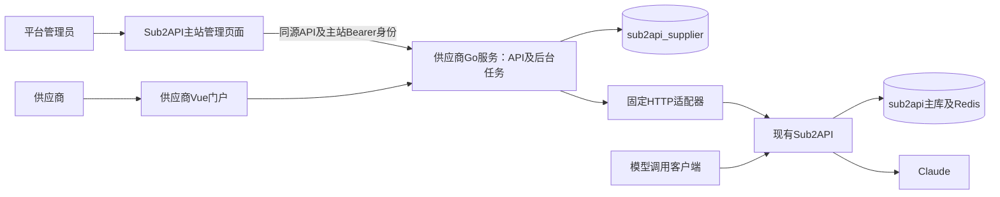

# 供应商模块架构方案

> 分组接入与账号启用流程以 [2026-10-23 接入调整](group-access.md) 为准。

日期：2026-10-22。版本：**Final PRD 1.0 / 精简方案 R2**。详细契约见 [首期详细设计](phase-1-technical-design.md)。

需求以老板提供的《最终PRD.md》（Final 1.0，2026-10-21）与《最终版HTML交互原型.html》为准。PRD SHA256：`55781446f3666e6c5826e2edfd068ee26b706d38f51a85ace4ef16010323a93e`。参考代码：`deployment-supplier-plan` / `a0d8370a13243ffdb136a2522a082b4164b8c0ad`，以及当前未提交的供应商模块源码。

**本文是目标设计，不是已实现声明。** R2保留Final PRD全部范围，减少工程机制，不通过删功能实现“简化”。本轮只改两份方案，不改代码、数据库或运行环境。

## 1. 一句话方案

**一个独立 Go 模块服务＋供应商 Vue 门户＋主站管理员页面＋一个模块数据库，复用现有表和 Sub2API 管理 API。** 后台同步、代理检测与授权任务先在该服务内运行；模型调用仍直接走 Sub2API，不经过供应商服务。

主站与模块可以共ECS、共PG实例，但数据库、账号、迁移与密钥分开。无需新增云数据库实例、Redis、MQ、独立任务服务或计费微服务。不改主站Ent、不直写主库，不复制Sub2API或React原型。供应商后端及门户仍放在 `extensions/supplier/`；管理员页面在主站前端独立目录接入，仅导航、路由、翻译及开发代理存在主站集成改动。上游 HTTP 差异集中于 `adapters/sub2api`。

## 2. 功能与身份

| 主体 | 产品范围 |
| --- | --- |
| 供应商 | 账号池、代理管理、用量统计三个菜单；管理员创建登录名/密码，无注册、成员管理或财务菜单 |
| 平台管理员 | 供应商列表、供应商财务管理；开户、启停、账户资料、指定供应商业务详情及结算登记 |
| 不做 | 钱包、提现、对账、余额调整、二次复核、待付款、自动支付、独立资金结算页 |

供应商使用模块本地凭据，管理员使用主站真实管理员身份；两种身份分别校验，不增加自定义角色。管理员不需要绑定供应商。停用登录身份要撤销旧会话，但不停止既有供给、不删除历史、不阻止管理员结算。

供应商可启停自家账号；授权健康、平台锁定、模型冷却/配额、代理有效性分别保存和校验。首期仍只支持Claude，不提供API Key或ChatGPT接入。常规准入按平台策略自动校验，不额外增加人工审批步骤。

## 3. R2删减了哪些复杂度

| R1机制 | R2处理 |
| --- | --- |
| 新API v2、双版本、桥接程序和兼容窗口 | 模块尚处本地开发，确认无外部消费者后直接调整现有v1并同发模块前后端；不改主站API |
| 独立supplier/admin会话表、独立凭据表 | 扩展现有sessions与suppliers；凭据仍受限访问，两种会话仍严格区分 |
| jobs、通用租约/fencing、独立执行器体系 | 复用operations做持久任务和失败恢复，先单实例；涉及外部不确定结果仍保留屏障 |
| 独立代理binding/reservation/secret表 | 账号proxy_id为正式绑定；operations记录临时容量保留和限时密文；共享授权单独一张grant表 |
| 模型状态、策略表 | 平台策略先用已有policy配置；模型/配额快照放已有observed_state，实际需要复杂查询再拆 |
| 日汇总表、跨HTTP快照协议、三套用量查询 | 首期一个用量接口，在一次一致性读取中返回四卡、日趋势和账号汇总；性能有证据再加投影 |
| 通用费率引擎、开账批次产品、数据库结算存储过程/触发器 | 规则先确认；用明确应用事务、行锁、唯一约束、幂等及审计保证结算，不堆叠多套机制 |

目标数据设计复用9类现有业务表，新增5类表（代理授权、余额、结算、流水、计提事件），而非R1的26类业务表。实例、历史映射和迁移元数据继续保留，不计入这项功能表对比。计提事件待规则明确后实施，不提前建设通用计价平台。

## 4. 主要实现方式

### 4.1 账号与代理

代理解析、权限、检测和容量先完成，账号接入再复用。容量计算为“未归档账号正式绑定＋未结束操作的保留”，同一代理行锁内核对；更换时保留旧绑定，直到主站更新读回成功才切换。未知结果不提前释放占用；有绑定/保留的代理不能删除。

OAuth绑定供应商、操作者、代理版本、允许分组、state/PKCE和过期时间，身份指纹全实例去重。显式隔离建号，确认代理/策略/身份后最后开启调度；无代理不直连降级。归档先停调度、清可用凭据、释放代理，保留用量墓碑。

`自动授权1`的真实Gmail授权链路仍需验证，采用同一operations任务流程，不能模拟成功或绕过挑战。如果确需浏览器执行器/专用出口，再按证据增加一个最小隔离边界，不先建设通用平台。

### 4.2 用量

复用usage_records与sync_cursors，后台按供应商全部账号逐日分页同步脱敏事件，持久进度、租约、失败重试及双遍摘要对账；历史日周期复核。一个接口按今天/近7天/近30天/全部历史和全部/单账号，在同一数据快照下返回四卡、日趋势和账号汇总；来源缺口明确显示不完整。账号池概览、实时指标及账号详情另按PRD口径读取，不以当前页求和。

官方价、用户扣款、采购应付三者不混用。全部调用尝试与成功计费日志不同；Fable、独立权重、实时并发或尝试数据无法从现有API可靠取得时显示未知并列出能力缺口，不能造数据或用priority替代权重。

### 4.3 财务

供应商列表行内是唯一结算入口；提交即完成登记。服务端单事务：幂等检查→锁最新余额→校验金额→余额更新→结算→唯一关联流水→审计→提交。金额用精确值；相同key同请求返回原结果，异请求冲突；不自动付款，也无二次复核。

余额、结算、流水保持独立，不能为了少表把财务记录塞进日志。采购计提按用户确认的官方标准消耗 1:1 USD 规则执行：不乘用户分组或账号倍率，保留18位小数、零头结转、按美分结算；用量、计提事件和余额同事务提交。存量已同步用量由010前向迁移一次补录，既有余额与已结算记录保留。历史下调不能侵占已结算金额，否则拒绝该次同步并保留原账。

## 5. 不可删减的约束与能力缺口

必须保留：服务端供应商隔离、实际管理员审计、密码散列/秘密加密、Origin/CSRF、OAuth唯一与幂等、代理容量锁、平台锁定、未知结果核对、归档保历史、结算事务与精确金额。

尚需验证/确认的事项集中在一处：

1. **业务口径**：误登记修复、导致应付低于已结算的历史修正、管理员密码恢复交付方式；已确认的计提及零头规则见详细设计。
2. **上游能力**：自动授权、独立权重、Fable、全部尝试/实时指标、模型级调度/冷却、代理正式出站保护。
3. **上线条件**：真实授权测试、容量与同步延迟、凭据与入口保护、备份恢复。已有Cloudflare部署不在本轮修改；涉及凭据传输的保护缺口在上线前另行解决。

“零核心修改”是优先策略，不是承诺全部PRD已有API可满足。若能力缺失，记录源码证据和最小补丁/接入方案，单独审批；不能直接改主库、绕过风控或用UI模拟已生效。

## 6. 实施顺序、迁移及验收

顺序：**身份与管理端 → 代理基础 → 账号池与授权 → 用量 → 财务 → 发布验收**。保持AC01–AC24，详细映射见详细设计。

复用当前Cookie/加密/幂等/适配器/测试，逐步扩展现有代码；001–005历史迁移不重写，只新增必要前向迁移。开发环境核实无外部供应商消费者后，模块前后端一次更新、撤销旧本地会话，移除旧review入口，不维护无必要的v1/v2双写。以后真有外部消费者时再设计兼容窗口。

每个阶段在隔离环境验证；无真实Claude测试账号不阻塞其他实现，但不能把真实授权验收标通过。主站和生产不用于试验。本轮不提交推送、不部署。

发布前备份模块库和密钥，确认旧程序能否读取新schema；当前checksum检查会拒绝未知迁移，不能简单退镜像或删迁移记录。模块回退也不会自动撤销已建账号或已登记结算。恢复应先隔离验证并核对外部副作用。

## 7. 源码依据与当前状态

- `backend/internal/handler/auth_handler.go`：主站登录要求邮箱，因此供应商本地登录名不能原样透传。
- `backend/internal/server/routes/admin.go`、`handler/admin/account_handler.go`：账号、OAuth、调度和用量管理接口。
- `backend/internal/handler/admin/proxy_handler.go`：代理协议、认证与fallback参数，不应全部下放。
- `backend/internal/service/usage_log.go`、`handler/admin/usage_handler.go`：费用、Token、日期/账号过滤，不能证明已覆盖全部尝试。
- `extensions/supplier/backend/internal/repository/migrations.go`：显式迁移、历史checksum及未知版本拒绝。

现有S1/S2是旧契约下的局部实现，见 [S1记录](s1-implementation-results.md)、[S2记录](s2-implementation.md)。原型是React内存演示，不是可直接上线的Vue代码。R2只简化工程方案，不改变这些事实。

## 主站管理员入口集成

主站管理页面、同源 Bearer 鉴权与兼容边界见 [主站管理接入设计](main-admin-integration.md)。
