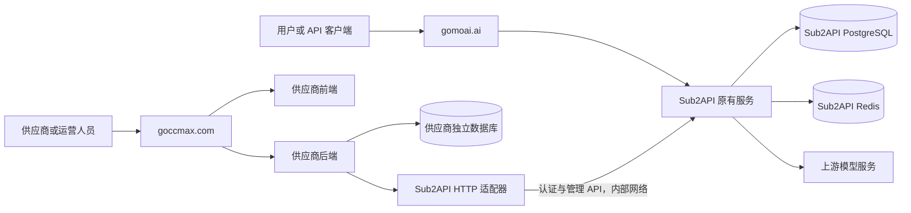

# 供应商模块架构方案

状态：供评审的设计方案；尚未实现业务代码或验证运行时集成。
日期：2026-10-20。
源码基线：`b0a02a3304a0a78cdd003ddda1dd23ba02c03084`，本地版本文件 `0.2.17`。
需求来源：Meegle 15451071「部署sub2api和自研新增供应商后台」。
参考范围：实际查看的 MixtusMax 供应商门户、账号接入弹窗、用量统计和代理管理。参考账户无账号、无使用记录，未验证非空列表的编辑操作。

## 1. 推荐决策

在现有 fork 仓库新增 `extensions/supplier/`，供应商模块具有独立前端、后端、数据库迁移、测试和镜像。通过 HTTP 管理接口适配器连接 Sub2API；模型调用继续直接进入 Sub2API。

目标是首版不修改现有 `backend/`、`frontend/`、Ent 生成代码和数据库迁移目录。这里的“零核心修改”是实施约束，不是对任意参考功能都能原样实现的承诺。不能通过现有接口实现的能力，必须明确作为兼容性缺口评审，不能偷偷写主库或在网关中加入供应商分支。

可以将其理解为同仓库维护的供应商控制台与配套服务。它属于我们的产品，但不是 Sub2API 当前的 `.s2plugin` 插件。

| 方案 | 上游合并影响 | 主要代价 | 选择 |
| --- | --- | --- | --- |
| 在上游 handler/service/页面中加入供应商判断 | 改动分散，容易冲突并影响调度 | 初期复用方便，长期维护困难 | 不采用 |
| 进程内独立包，加启动与路由接入点 | 少量接入冲突，仍耦合 Go 内部接口、Wire 和 ORM | 上游签名及数据结构变更会传播 | 接口能力不足时的后备方案 |
| 独立服务，通过 HTTP 适配器集成 | 核心源码无需接入改动，变化集中于适配器 | 多一个部署单元，需要处理跨服务一致性 | 首版推荐 |

当前插件协议主要支持 `openai.oauth.outbound_transport.v1`，不提供供应商身份、业务路由和账号管理扩展契约；不为本需求修改传输插件体系。

## 2. 运行边界



- `gomoai.ai`：现有用户门户、管理后台及模型 API。
- `goccmax.com`：供应商门户；其 `/api/supplier/v1` 只进入供应商后端。
- 供应商运营功能可放在该门户的 `/ops`，后端检查平台管理员身份。首版不修改上游侧边栏。
- 供应商服务停机不应阻断已纳管账号的正常模型请求；账号调度、凭据刷新、限流、转发、计费仍由 Sub2API 执行。
- 供应商服务不可用时，供应商的登录、读取和配置操作报错，不返回伪造的零用量或“操作成功”。
- 独立数据库可与主库位于同一 PostgreSQL 实例，但使用不同数据库、账号和迁移历史。不要修改上游 `users`、`accounts`、`usage_logs` 的表结构。

## 3. 代码组织

以下为拟定结构；本轮只创建本方案文档。

```text
extensions/supplier/
  backend/
    go.mod                         # 独立 Go module
    cmd/server/                    # 模块入口
    internal/
      auth/                        # 会话、成员资格、操作人身份
      supplier/                    # 供应商档案与策略
      account/                     # 账号归属、接入与管理规则
      proxy/                       # 代理归属与检测
      usage/                       # 用量读取、汇总、同步
      audit/                       # 供应商操作审计
      ports/                       # 模块依赖的窄接口
      adapters/sub2api/            # 唯一感知上游 HTTP 协议的位置
      repository/                  # 只访问供应商数据库
    migrations/                    # 自有迁移及版本表
  frontend/
    package.json
    pnpm-lock.yaml                 # 独立依赖和锁文件
    src/features/                  # 登录、账号池、用量、代理、运营
  deploy/
    Dockerfile
    compose.supplier.yml           # 显式加载的附加 Compose 文件
    Caddyfile.example
  contracts/                       # 模块 OpenAPI、脱敏契约样本
  tests/compatibility/             # 上游版本契约与集成验收
  docs/architecture.md
```

业务服务只依赖 `ports` 定义的账号、OAuth、代理和用量接口。上游 URL、请求字段、分页、错误码和 DTO 转换全部留在 `adapters/sub2api`；业务代码不直接依赖上游 Go 类型。

不复制整套 Sub2API 后端或前端，不把供应商实体加入上游 Ent Schema，不借用上游 `extra` 或 `notes` 作为供应商权限数据库。恢复用操作标记可以放入受控元数据，但它不能证明资源归属。

## 4. 功能范围与现有能力映射

所有上游接口均位于 `/api/v1` 下。以下是源码确认的候选接口，尚未完成真实服务联调。

| 供应商能力 | 上游能力 | 模块负责的部分 |
| --- | --- | --- |
| 登录及身份确认 | `/auth/login`、`/auth/login/2fa`、`/auth/refresh`、`/user/profile` | 独立会话、供应商成员资格、停用检查 |
| 账号列表及详情 | `/admin/accounts`、`/admin/accounts/:id` | 归属筛选、分页、状态转换、响应字段白名单 |
| Claude OAuth 接入 | Anthropic `/admin/accounts/generate-auth-url`、`exchange-code` | 流程绑定、平台与账号类型校验、回调验证、凭据不下发、待准入流程 |
| 账号配置 | `/admin/accounts/:id`、`/:id/schedulable` | 可修改字段白名单、平台上限、准入权限 |
| 今日用量与额度状态 | `/admin/usage`、`/admin/accounts/today-stats/batch`、`/admin/accounts/usage/batch` | 同步明细聚合六项今日卡片，批量接口读取额度及核对可比统计 |
| 供应商全部账号历史明细 | `/admin/usage`、`/admin/usage/stats` | 按账号同步，按供应商归属筛选、统一排序分页及费用口径 |
| 代理创建、绑定、检测 | `/admin/proxies`、`/:id/test`、`/:id/quality-check` 及账号更新 | 代理归属、敏感字段裁剪、跨供应商隔离 |
| 供应商运营 | 模块新接口 | 开通、成员管理、账号审批、上限、审计 |

首版范围已确认：仅支持 Claude（Anthropic）OAuth 账号，覆盖账号池、OAuth 接入、用量、代理管理，以及供应商开通与准入控制。同一供应商可接入多个 Claude 账号；ChatGPT/OpenAI、其他平台及 API Key 接入不纳入首版。

首版添加账号直接进入 Claude 授权流程，服务端仅接受 `platform=anthropic`、`type=oauth`。保留平台适配边界，后续扩展另行确定范围并完成兼容性验证。

### 4.1 不照搬参考站的配置语义

- 并发：Sub2API 有 `concurrency`，按现有语义执行，模块只允许平台策略范围内的值。
- RPM：已有 `extra.base_rpm` 和 `rpm_strategy`，当前调用点涉及 Anthropic OAuth/setup-token，并含粘性会话策略。不能承诺所有平台统一硬性 RPM 上限；按平台能力展示，未验证的平台不开放设置。
- 权重：参考站的“1～1000，越大分配越多”不能直接映射到 `priority`。Sub2API 的较小 priority 更优，`load_factor` 也不是相同语义。首版不提供未经验证的等价权重；如需要供应商自定义流量配比，单独评审实现成本。
- 未填写并发/RPM时，不直接向上游传零值或无限制。由适配器按该字段真实语义解析平台默认值，防止“留空”绕过平台限制。
- 参考站展示的是计算费用，当前没有验证到结算、提现功能；首版不将该费用命名为应付收益。
- 配额窗口和状态标签按上游真实平台返回值显示，不强行套用参考站的固定窗口名称。

## 5. 身份、权限与数据归属

### 5.1 复用登录，不扩展上游 role

首版建议复用 Sub2API 现有用户身份，供应商资格保存在模块数据库的成员表中，不把上游 `user/admin` 改成 `user/admin/supplier`。

供应商门户经后端白名单认证接口完成登录与 2FA，模块将上游 Token 加密保存在服务端会话中，浏览器只持有本站的 HttpOnly、Secure 会话 Cookie。写操作使用 CSRF 防护。通过 `/user/profile` 验证上游身份与账号状态，再检查模块成员及供应商状态；验证失败即拒绝，不只本地解码 JWT。

不自动共享两个域名的 Cookie，不向浏览器下发管理员 API Key。首版采用运营开通供应商、关联既有用户的方式；自助申请、第三方登录扩展和跨域 SSO另行评审。

上游若启用了仅后台模式、会话 IP/UA 绑定或额外登录限制，适配器必须兼容其真实行为。原始客户端信息只经可信反向代理传递；不得以关闭上游校验作为默认解决方法。

### 5.2 服务端资源校验

每个读写入口都必须校验：登录用户 → 供应商成员资格 → 资源归属 → 允许动作 → 字段范围。覆盖账号、代理、OAuth 会话、任务及批量 ID。

- 供应商身份从服务端会话推导，不能信任客户端提交的 supplier_id。
- 先校验完整 ID 集合，再发起批量操作；不把其他供应商 ID 透传上游。
- 不允许供应商自选运营分组、计费倍率、准入标志、任意 credentials/extra、平台级调度参数。
- 上游响应通过模块 DTO 白名单重建，剔除凭据、代理密码、下游用户身份、API Key、IP及请求/响应内容。
- 不向外提供通用的管理员 API 转发器。

Sub2API 当前管理员 API Key 具有广泛权限，并非供应商范围的服务凭证。仅由内部适配器持有，通过内部网络调用固定接口；模块必须记录实际供应商与操作人，因为上游机器调用审计可能归到同一个管理员。上线前需验证对应管理员已满足上游既有初始化条件；若接口要求人工二次认证，返回需人工处理，不绕过门控。

## 6. 数据模型与一致性

建议模块自有表：

| 表 | 主要内容 |
| --- | --- |
| suppliers | 名称、状态、策略版本 |
| supplier_members | supplier_id、upstream_user_id、成员权限及状态 |
| supplier_accounts | 模块 ID、upstream_instance_id、upstream_account_id、supplier_id、准入状态 |
| supplier_proxies | 代理归属与上游 proxy_id，不保存重复的长期代理凭据 |
| supplier_oauth_sessions | 供应商、操作人、平台、代理、上游会话、过期时间和消费状态 |
| supplier_operations | 幂等键、状态机、上游操作结果及补偿状态 |
| supplier_usage_records | 脱敏用量读取模型与原始费用快照 |
| supplier_sync_cursors | 每个上游账号的同步水位、重叠窗口及完整性状态 |
| supplier_audit_events | 操作人、资源、动作、结果、关联操作 ID |

`(upstream_instance_id, upstream_account_id)` 的有效归属唯一。首版禁止有历史用量的账号直接转移供应商；确需转移时，应设计带生效时间的归属历史，不能用当前归属解释全部历史消费。删除账号保留归属墓碑和已有用量，不级联抹掉历史。

### 6.1 新建账号与调度准入

源码确认：`adminServiceImpl.CreateAccount` 在 `GroupIDs` 为空时可能自动绑定平台默认分组。因此“不给分组就不会接流量”是不成立的。

流程建议：

1. 模块持久化操作 ID，绑定供应商、OAuth 会话及准入策略。
2. 用显式配置的待审核隔离分组创建账号，该分组不得绑定生产 API Key、授予用户权限或进入生产路由；不能传空分组。
3. 记录上游账号 ID与归属，并设置不可调度；两个服务没有分布式事务，期间由隔离分组保证不承接生产请求。
4. 平台审核后绑定批准的生产分组，最后开启调度；失败保持待处理，不返回成功。
5. 响应丢失时先对账，不能盲目重试非幂等创建。模块状态机与受控操作标记用于发现孤立账号，无法唯一确认时交由运营处理。

隔离分组机制必须通过真实网关测试，覆盖默认组、兜底组和合成路由。若无法保证待审核账号不进入生产调度，应明确提出最小上游管理接口补丁，而不是带着竞态上线。

供应商可暂停自己的账号；恢复首版交由平台确认，避免供应商将管理员停用的账号重新启用。平台准入与供应商期望状态分开记录，最终上游状态不得因供应商操作越过平台限制。

## 7. 用量与费用口径

本页以当前登录供应商为统计范围，默认查询其名下全部 Claude 账号的用量，支持进一步筛选单个账号。

- 账号下拉默认选择“全部账号”，可选项仅包含当前供应商有权查看的账号。
- 今日卡片汇总该供应商全部账号的请求数、输入 Token、输出 Token、缓存读取 Token、缓存写入 Token 和计算费用（USD），并显示汇总更新时间。
- 请求明细合并该供应商全部账号的记录，显示所属账号，按请求时间倒序统一分页。支持今日、昨日、最近 7 天、最近 30 天及自定义日期范围；模型筛选为精确匹配，留空表示全部模型。
- 供应商身份由服务端会话确定；全部账号查询和单账号筛选都须校验归属，禁止读取其他供应商的数据。

现有 `/admin/usage` 支持单个 `account_id` 过滤，是模块逐账号同步的数据来源。页面上的“全部账号”由供应商模块整理完整归属集合后统一查询，历史范围保留已删除账号的归属墓碑；不能受限于上游的单账号查询方式，也不能读取全平台分页后在前端过滤。

六张今日卡片与跨账号历史明细统一基于模块后台同步的脱敏读取模型，按供应商完整归属集合聚合，不能仅统计当前列表页的账号。现有 `today-stats/batch` 仅返回请求数、总 Token 和费用字段，不含输入、输出及缓存 Token 拆分；它用于核对可比统计，不能直接覆盖全部卡片。账号额度状态仍通过 `usage/batch` 查询。同步与查询规则如下：

- 同步逐账号发起带有效正整数 account_id 和时间范围的请求，遍历各账号、各时间窗口的全部分页，限制并发，遵守上游面板限流。不得用空值或 0 表示全部账号传给上游，以免丢失账号过滤。
- 按上游实例与用量记录 ID 幂等去重；重叠窗口重读，处理延迟写入，失败保留水位并重试。
- 页面查询先在模块读取模型中按供应商归属、可选账号、日期和模型过滤，再按请求时间倒序及唯一记录键稳定排序，最后统一分页；明细总条数基于完整筛选集合，不拼接各账号的局部页面冒充全局分页。
- 首次回填完成前标注未完成；上游明细被清理而尚未同步时标注缺口，不能补成零。
- 今日卡片和明细使用同一同步读取模型，展示最后同步时间及完整性状态；不将尚未同步齐全的数据标为完整统计，也不作为未经对账的结算结果。
- 模块读取模型只保存必要计数与费用，不保存请求正文、响应正文和下游用户信息；保留周期独立配置。

费用区分上游 `TotalCost`、`ActualCost` 与账号统计费用。源码确认账号统计按每条记录的 `COALESCE(account_stats_cost, total_cost) × COALESCE(account_rate_multiplier, 1)` 汇总：先取账号统计费用基数，缺失时取 total_cost，再乘账号倍率；倍率缺失时按 1 处理。两字段只有 NULL 才回退，0 是有效值。

管理 DTO 已确认返回 `account_stats_cost` 和 `account_rate_multiplier` 原始字段，调用方仍需按上述公式计算。联调时验证与账号统计接口的结果一致，并覆盖独立费用基数、历史空值、零值及非默认倍率。不能拿下游用户的实际扣款直接当供应商收益；模块金额使用定点数或 decimal，不用二进制浮点重复累计。

统计时区采用北京时间（Asia/Shanghai），按半开区间计算日界。按参考页面口径，日期、账号和模型筛选用于请求明细；卡片始终展示当前供应商全部账号的今日合计，界面明确区分“今日汇总”和“所选范围内的请求明细”。

## 8. 上游同步与发布

### 8.1 Git 边界

- 保留上游现有目录和 module import 路径；自研内容集中在 `extensions/supplier/`。
- `origin` 指向自己的 fork，`upstream` 指向官方仓库；实际操作前核对 remote，不在本轮改变分支或远程配置。
- 在临时集成分支合并选定的 upstream 提交，保留上游历史，避免用 squash 导入上游造成重复合并困难。
- 供应商源码、构建、迁移、测试分成独立提交。将来确有核心补丁时，单独提交并记录原因、影响文件、上游替代条件。
- 兼容性检查应比较“同步前的 fork”与“集成后的 fork”的本次改动，不将 fork 原有差异误判为本模块改动。
- 不承诺永远无冲突：上游 HTTP 协议、默认行为和依赖变化仍需适配，只是影响集中在模块边界。

### 8.2 兼容性验证

每次升级对实际部署的 fork 提交及供应商模块提交、镜像组合运行真实集成测试，至少覆盖：

1. 用户登录、2FA、刷新、撤销与模块成员停用。
2. 管理员机器认证以及可能的 401/403/423/429 响应。
3. Claude 账号接入、隔离分组、审批入池、暂停和平台封停；创建超时及补偿。
4. Claude OAuth state、会话过期、重复消费、跨供应商会话挪用；拒绝首版范围外的平台或接入类型。
5. 账号与代理的单项、批量及异步任务越权。
6. 用至少两个供应商验证用量隔离，其中一个供应商含多个账号；核对全部账号的六项今日汇总、跨账号明细排序和分页、日期/账号/模型筛选、Token 与费用，以及同步延迟、缺口和去重；修改明细筛选条件不改变今日卡片的统计范围。
7. 供应商服务停机时，原网关仍可正常请求、流式输出与计费。
8. 更新字段时保留上游无关配置；接口不兼容时停止相应写操作并明确报错。

发布前在本地执行上游原有检查与模块检查。通过契约验收后，在兼容矩阵中记录实际测试过的源码 SHA、构建参数、镜像 ID、镜像包 SHA256 和验收结果；不只凭版本字符串判定兼容。

### 8.3 部署与回退

部署沿用[主站部署方案](../../../ops/deployment/PLAN.md)的本地构建与镜像包交付流程。当前先部署主站；供应商模块开发恢复并通过验收后，再增加供应商服务。

主服务镜像从本地 fork 的固定提交构建，供应商镜像独立构建，目标架构均为 `linux/amd64`。两者分别使用固定标签，经 `docker save` 导出、SSH 上传、校验包 SHA256 后在服务器执行 `docker load`，核对镜像 ID 与架构。Compose 使用对应本地标签及 `pull_policy: never`，保留旧镜像包和发布记录用于回退。

供应商附加 Compose、反向代理配置及构建部署脚本在 `extensions/supplier/deploy/` 维护，与 `ops/deployment/` 中的主站配置显式组合加载。若需要修改上游 `.dockerignore` 等构建边界，单独记录为小型接入补丁。

模块迁移使用自己的迁移表和数据库权限，不加入上游顺序编号，不修改既有迁移。发布前分别备份两个数据库及密钥；回退程序不等于回退数据库。门户关闭后模型调用可继续，但已写入主服务的账号和配置仍存在，需要按操作审计单独处置，不能把停容器当成撤销业务变更。

## 9. 实施顺序与待验证项

1. 接口验证：在隔离的 Sub2API 实例验证认证、Claude OAuth、隔离分组、账号统计及代理操作；核对 Claude 账号额度展示与费用计算结果。
2. 模块骨架：独立工程、数据库迁移、登录、成员资格和适配器契约测试。
3. 账号闭环：开通供应商、Claude OAuth 接入、归属、平台准入、暂停和审计。
4. 用量与代理：统计、同步、筛选、代理绑定及检测，补齐异常恢复。
5. 部署和升级演练：双域名、权限隔离、供应商服务故障测试、上游升级与回退。

本方案仍需在实施前确认：服务器资源及供应商数量/账号量、用量保留周期、账号恢复审批体验。收益结算、提现、自助申请及参考站原样权重不纳入未经确认的首版承诺。

## 10. 本轮源码依据

- `backend/internal/server/routes/admin.go`：账号、OAuth、代理、用量路由。
- `backend/internal/server/routes/auth.go`、`user.go`：登录及 profile。
- `backend/internal/server/middleware/admin_auth.go`：管理员 API Key；`step_up.go`：机器凭证不能替代人工二次认证。
- `backend/internal/handler/admin/account_handler.go`：concurrency、priority、load_factor 及批量用量接口。
- `backend/internal/handler/admin/usage_handler.go`、`backend/internal/repository/usage_log_repo_query.go`：单账号过滤、时间范围、分页；account_id 必须为正整数才生效。
- `backend/internal/service/account_usage_service.go`：批量今日统计字段边界，未提供输入/输出/缓存 Token 拆分。
- `backend/internal/service/admin_account.go`：默认分组自动绑定行为。
- `backend/internal/service/account.go`、`gateway_scheduling.go`：RPM 语义及使用范围。
- `backend/internal/service/openai_account_scheduler.go`：优先级、负载和调度评分。
- `backend/internal/service/usage_log.go`：费用及账号统计费用快照。
- `backend/internal/repository/usage_log_repo_stats.go`：账号统计费用计算公式。
- `backend/internal/handler/dto/types.go`、`mappers.go`：管理用量响应的费用基数与倍率字段。
- `backend/pkg/pluginapi/README.md`：现有插件能力边界。

本轮仅完成静态源码核对和设计，没有宣称上述接口已通过运行时兼容验证。
