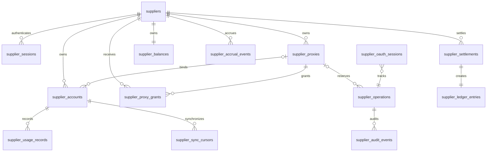
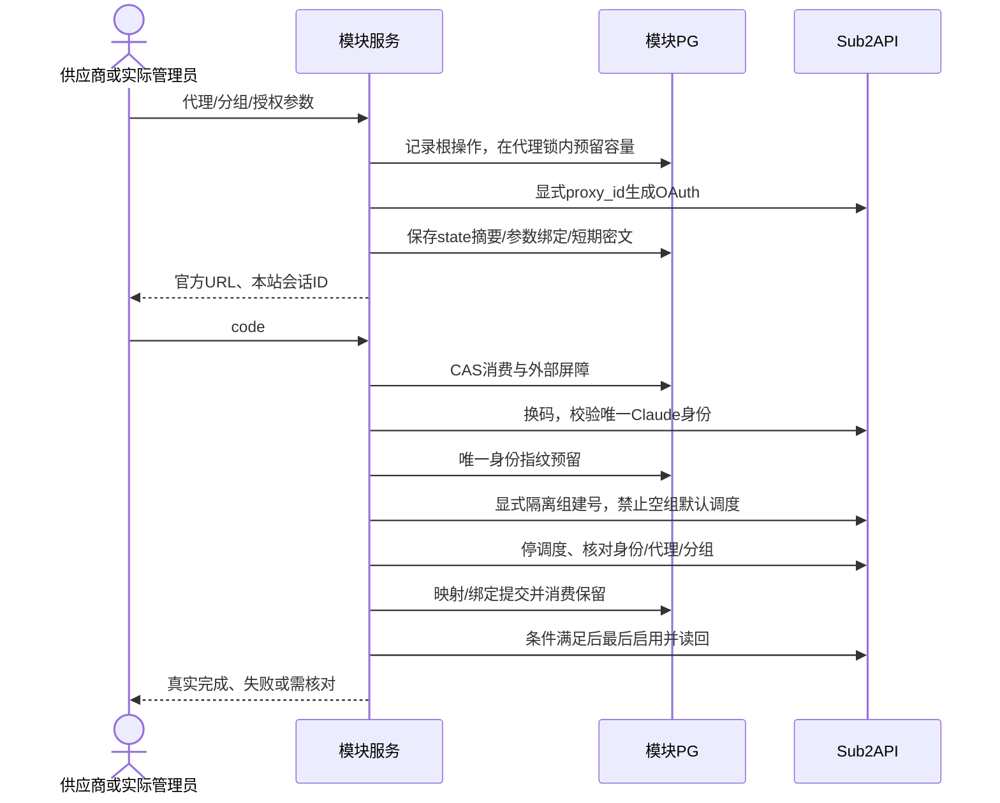

# 供应商模块首期详细设计

> 分组接入与账号启用流程以 [2026-10-23 接入调整](group-access.md) 为准。

日期：2026-10-22。版本：**Final PRD 1.0 / 精简方案 R2**。上位设计：[architecture.md](architecture.md)。
需求：老板提供的《最终PRD.md》Final 1.0及配套HTML原型。PRD SHA256：`55781446f3666e6c5826e2edfd068ee26b706d38f51a85ace4ef16010323a93e`。参考分支 `deployment-supplier-plan`，HEAD `a0d8370a13243ffdb136a2522a082b4164b8c0ad`，包含另行核对的未提交supplier源码。

**这是目标设计，不是已实现声明。** 本轮只改方案，不改业务代码/依赖/迁移/运行服务，不提交推送。R2保留PRD功能、安全和AC01–AC24，仅精简实现机制；旧参考SQL、README和 [S1](s1-implementation-results.md)/[S2](s2-implementation.md) 为历史实现记录，不能替代本设计验收。

## 0. 精简后的执行边界

### 0.1 保留什么、删减什么

| 保留的产品能力/正确性 | 不提前建设的机制 |
| --- | --- |
| 供应商三个菜单；平台供应商列表/财务管理；开户、启停、业务详情 | 不加成员/角色管理、注册、钱包/提现、复核、自动付款 |
| 本地供应商登录、主站管理员认证、会话撤销与实际主体审计 | 不另建凭据表和两套会话表，扩展suppliers/sessions |
| Claude OAuth与自动授权任务、平台锁定、多维健康、归档 | 不加常规人工审批；不按原型demo伪造授权成功 |
| 代理共享可见性、容量、检测、批量导入、删除约束 | 不独立拆binding/reservation/secret/jobs表和任务服务 |
| 四卡、日趋势、账号汇总、真实尝试与官方价、缺口提示 | 不先建日汇总表、跨HTTP snapshot_id协议或独立遥测平台 |
| 精确余额、同库结算事务、幂等、流水和审计 | 不先建通用费率引擎、开账批次产品、结算存储过程/触发器 |
| 不改上游核心、独立库/镜像、历史迁移校验 | 模块尚在本地开发，确认无外部消费者后直接更新现有v1，不引入双版本/桥接程序 |

**运行结构：一个Go服务（API＋进程内后台任务）、供应商Vue门户及主站管理员页面、一个模块数据库。** 模型调用、长期Claude凭据、Token刷新、正式调度仍在Sub2API；模块只调用固定HTTP适配器，不直读写主库。模块可与主站同ECS、共PG实例但分数据库/角色，不新建Redis/MQ。

当前v1登录与供应商映射属于旧实现，不能默认为新契约已经可用。首期只支持Claude；原型其他平台种子不进入范围。独立权重、Fable、全部调用尝试、模型级调度与自动授权存在上游能力依赖，见第7节。

## 1. 表结构与关系图

### 1.1 设计原则

数据库仍是 `sub2api_supplier` / schema `supplier`。复用9类业务表、新增5类表；现有upstream_instances、supplier_members历史映射及迁移元数据保留，但不新增对应产品能力。以下为目标逻辑表，不是本轮已执行DDL。

通用字段id UUID、created_at/updated_at UTC、version正bigint。上游bigint ID以JSON字符串返回。资源supplier_id不可变，外键默认RESTRICT；归档/停用不级联删除历史。实体写权限与查询DTO分开，供应商名称或客户端supplier_id不能作为授权依据。

### 1.2 复用现有业务表（9类）

| 表 | 本期字段与必要调整 | 关键约束 |
| --- | --- | --- |
| `suppliers` | name、portal_status、policy，增加login_name/login_normalized、password_hash、credential_version/session_epoch | 登录名trim/lower后唯一，ASCII4–64位`[A-Za-z0-9_.@-]`；名称1–100字符；一供应商一凭据；密码/散列不入DTO |
| `supplier_sessions` | 复用cookie哈希、CSRF、密文和到期字段，增加principal_kind、actor_id及凭据/epoch快照 | local_supplier与admin类型约束分开；本地供应商不持上游Token，管理员才持加密Token；旧ops行仍撤销，不能改kind取得权限 |
| `supplier_accounts` | supplier_id/upstream映射/name、note、identity_fingerprint、auth_method、proxy_id；增加supplier_enabled、platform_locked、lifecycle；observed_state保存健康/模型配额/冷却/并发等快照 | `(instance,upstream_account_id)`唯一，身份HMAC同实例全局唯一；归属不转移；归档留墓碑；凭据不存此表 |
| `supplier_proxies` | supplier_id作为owner、上游映射、protocol/host/port、region、capacity、test_state/时间/延迟、credential_version、endpoint_fingerprint | port1–65535，capacity>0；同owner规范化endpoint/认证指纹唯一；新建untested；脱敏地址DTO |
| `supplier_oauth_sessions` | supplier/actor、purpose/target、proxy及凭据版本、group策略版本、params_hash、state摘要、限时上游会话密文、expires_at、operation_id | 绑定参数、CAS单次消费、短于上游TTL；不向前端暴露上游session_id/PKCE秘密 |
| `supplier_operations` | 复用key/hash、状态/步骤/安全结果/短期密文，补actor_kind/id、parent_operation_id、run_after/attempts、reserved_proxy_id、hold_state | actor/action/key唯一，hash含目标/正文/前置版本；单资源in-flight屏障；容量保留只在根操作记录，子操作不重复占槽 |
| `supplier_usage_records` | 扩展source/source_id、record_kind、attempt_key/request_key、source_revision、supplier/account归属快照、模型、Token分项、官方价、结果与延迟质量 | `(instance,source,source_id)`唯一；可靠attempt_key跨来源去重/关联，不能把usage和错误条数直接相加 |
| `supplier_sync_cursors` | 复用账号/来源/时间窗、水位，补scan状态、last_success_at、completeness/gap_reason | 完整扫描才推进水位；单账号失败不能被其他成功掩盖 |
| `supplier_audit_events` | 扩展actual actor_kind/id、target_supplier_id、operation/request_id、safe_summary | append-only，真实管理员与目标供应商分开；无密码、code、Token、代理认证或下游客户数据 |

sessions需前向调整旧“依赖member_id/upstream_user_id”的约束，允许新本地supplier与无供应商绑定的admin；历史列保留，不靠随便填上游用户ID通过校验。operations/audit同样新增显式主体字段，并按新旧记录类型调整旧bigint操作者的空值约束；不重写历史审计身份。

平台允许分组、并发上限、权重等先使用已有policy与部署配置，带policy_version，供应商不能改。模型状态用observed_state中的版本化白名单结构保存，含model/window/source/observed_at/unknown；不是无约束extra透传。

代理正式绑定直接来自未归档account.proxy_id；不额外维护另一份绑定表。旧复合FK强制代理同supplier，必须前向改为实例+proxy引用，再由统一业务入口在代理行锁内验证owner/grant。所有绑定、删除、授权变化都走同一锁规则，不能简单删FK就开放共享。

### 1.3 新增业务表（5类）

| 表 | 关键字段 | 约束与用途 |
| --- | --- | --- |
| `supplier_proxy_grants` | proxy_id、grantee_supplier_id、can_use、expires_at、version | UNIQUE(proxy_id,grantee_supplier_id)；保留PRD既有授权可见性，无共享管理菜单；默认私有 |
| `supplier_balances` | supplier_id PK、currency=USD、unsettled_cents、settled_cents、accrual_remainder numeric(38,18)、version | 整数美分，非负且算术防溢出；新供应商余额/余数全0，总消耗余额由两者求和 |
| `supplier_settlements` | id/全局唯一settlement_no、supplier_id、amount_cents、method、reference/note、status=completed、key/hash、before/after、实际操作者和名称快照 | amount>0、method白名单；操作者/动作/key唯一，hash包含目标supplier；只读，不提供撤销/编辑 |
| `supplier_ledger_entries` | id/全局唯一ledger_no、settlement_id、supplier_id、delta_cents、before/after、currency、actual_actor、created_at | settlement_id UNIQUE/FK；delta=-amount，after=before+delta；与结算同事务、同金额/供应商 |
| `supplier_accrual_events` | supplier_id/account_id、upstream_instance_id/upstream_usage_id/source_version、rule_revision、origin、previous_cost/standard_cost/exact_delta、posted_cents、before_cents/after_cents、remainder_before/remainder_after、created_at | 010已实现；来源/修订/规则唯一，关联来源记录和账号归属，精确记录差额与结余；不新增费率管理页面 |

用量/计提用 `numeric(30,12)` 或等价精确decimal，结算金额用整数美分；API金额全部十进制字符串，禁止二进制浮点累计和逐请求截两位小数。费率配置初期采用受控、带版本的明确规则，快照写入计提事件；不先建规则引擎/费率表。存量开账用另行批准的核验文件、幂等导入脚本和审计，不预建开账批次系统。

余额/结算/流水三表不能合并进operations日志。结算通过唯一业务事务方法写三表并检查影响行数/关联，数据库保留FK、唯一和CHECK；不额外上存储过程或延迟触发器。测试必须验证任一步异常都回滚、无completed结算缺流水。运行角色不具备DDL或历史财务UPDATE/DELETE权限；新增财务业务入口必须复用该事务方法。



## 2. 权限矩阵

| 能力 | 供应商 | 平台管理员 |
| --- | --- | --- |
| 登录 | 本地login_account/password，无自助注册 | 主站邮箱认证；已有2FA挑战如实完成，无supplier绑定要求 |
| 账号/代理/用量 | 当前supplier及获授权代理 | 显式选定supplier，与供应商共用业务service/组件 |
| 开户/资料/登录启停/密码重置 | 不可 | 可，实际主体审计；重置不回显旧密码并撤销会话 |
| 账号启停、名称/备注/代理、重授权、归档 | 自家；启用不解除平台锁/配额/认证问题 | 目标范围相同规则，不能伪装供应商操作者 |
| 账号分组/并发/权重 | 添加时只能选允许组，编辑组只读；并发和weight只读 | 平台受控策略配置，不新增PRD外菜单 |
| 共享代理删除/他人账号身份 | 不可；只自有无绑定/保留可删除 | 仍遵守占用和授权约束 |
| 全平台统计 | 仅白名单聚合，不下钻其他supplier | 同聚合或已授权目标资源 |
| 余额/结算/流水 | 不可 | 可；目标supplier登录停用不影响历史结算 |
| members/旧ops/评审角色切换 | 不提供 | 不提供；平台业务API不是旧ops权限恢复 |

服务端统一Principal与ResourceScope：supplier_id从供应商会话取；管理员路径显式target并校验存在/授权。supplier跨租户资源404；已知管理目标无权限403、不存在404。缓存、批量、后台任务复用同scope，外部写前再次确认权限/策略；混入他人ID整批拒绝，不发越权上游调用。

### 2.1 最小安全要求

- 密码散列用成熟KDF（优先主站已依赖的Go crypto库），随机salt和可升级参数；10–64字符、字母+数字；错误/不存在/停用统一提示并限速，散列不入列表/详情。supplier凭据和主站admin认证不混用。
- 复用现有HttpOnly/Secure/SameSite Cookie、Origin/CSRF与加密实现。supplier/admin可共用sessions表但Cookie及kind隔离，AAD含kind/主体；每请求核对状态/credential_version/session_epoch。停用或重置在事务内递增epoch并撤旧会话；不改变供给账号。
- 管理员每次校验主站profile ID/admin/active，敏感操作前复核；不绕过2FA/合规/step-up。上游机器Key仅固定服务端适配器持有，实际操作者另记审计。
- 密码、Gmail应用密码、代理认证、code/Token不进日志/URL/前端持久存储。临时秘密复用operations已有分域加密字段、key_id和期限，完成/明确失败后清除，不建专用secret系统。Claude长期凭据留主站；代理临时创建材料确认成功后擦除。
- 代理检测及正式出站都需防SSRF、DNS重绑定、元数据/私网/loopback/IPv6变体和直连fallback，固定检测目标；单次输入解析不能保证网关安全。现有主站无法强制时列能力缺口，不上线假安全实现。

## 3. 接口定义

### 3.1 单版本与公共规则

供应商沿用 **`/api/supplier/v1`**；平台使用 **`/api/supplier/admin/v1`**。不增加供应商v2或维护双版本。依据是当前模块仅本地开发、尚无生产供应商；实施前核实无第三方消费者，模块前后端同步调整并撤旧本地会话。若发现真实消费者，停止直接破坏契约，补最小过渡方案。

成功 `{code:0,message,data}`，错误含安全reason/request_id及真实HTTP状态。未知指标null/—并附source/as_of/completeness，不伪造0。ID字符串、时间UTC RFC3339；展示及日期过滤按上海自然日，包含结束日，转成UTC半开区间。

分页服务端处理：账号池5/10/20/50默认50；其他默认20上限100，合法sort白名单且id稳定次序。可变实体写操作If-Match，缺428、冲突409；创建/状态/任务/结算带UUID Idempotency-Key，同key同参数返原结果，异参数409。开户201、结算201/重放200，跨服务任务202 `{operation_id,state}`；前置校验失败不能误返回已受理。

### 3.2 登录、供应商管理

| 前缀 | 路径 | 输入/结果 |
| --- | --- | --- |
| supplier | POST `/auth/login`、POST `/auth/logout`、GET `/me` | login_account/password；me仅安全身份、supplier和csrf；Cookie不返Token；登录后账号池 |
| admin | POST `/auth/login`、`/auth/login/2fa`、POST `/auth/logout`、GET `/me` | 复用主站真实认证/刷新与已有挑战；admin不需要supplier映射 |
| admin | GET/POST `/suppliers` | 查询仅名称/登录名；创建name/login_account/initial_password，同事务建0余额，无资源种子 |
| admin | GET `/suppliers/{id}` | 账户资料与状态，无密码/散列 |
| admin | PUT `/suppliers/{id}/status` | enabled、version/key，停用原子撤全部会话，不删除业务 |
| admin | POST `/suppliers/{id}/credential-reset` | 管理员受控新密码、version/key、审计及撤会话；无独立菜单 |

登录名trim/lower唯一4–64位，名称trim后1–100字符。密码恢复从账户资料受控操作承载，具体弹窗/安全交付渠道需产品确认，不默认引入短信/邮件服务。

### 3.3 账号、代理、用量

下表为supplier路径；管理员以admin前缀的 `/suppliers/{supplier_id}` 加同一路径复用服务和组件。operation轮询在各身份前缀 `/operations/{id}`，必须校验实际主体和目标范围。

| 方法/路径 | 首期契约 |
| --- | --- |
| GET `/accounts` | search、health/enabled、group、auth_method、cooldown、schedulable、archived_only、创建日期、fault、sort/page；AND组合 |
| GET `/accounts/overview`、`/accounts/faults`、`/platform-summary` | overview全自家、faults基础筛选不含fault本身、platform仅安全全局汇总，不用当前页求和 |
| GET `/accounts/{id}`、`/accounts/{id}/usage` | 详情含状态/原因/脱敏代理/分组/只读并发和weight/额度；用量all或today及固定5h/7d/30d窗口、趋势/模型/匿名来源 |
| GET `/account-options` | 允许组、代理选项、地区/协议/授权能力；只返回可见字段，必要时分页过滤 |
| POST `/oauth/sessions`、POST `/oauth/sessions/{id}/complete` | 名称可空、备注、proxy_mode(auto/existing/new)、proxy参数、group、purpose/target；code#state、key，complete不可改参数 |
| POST `/authorization-tasks` | gmail_email/app_password和同一代理/分组参数；operations持久任务，不返回秘密 |
| PUT `/accounts/{id}`、PUT `/accounts/{id}/enabled` | 白名单name/note/proxy_id，省略代理保留原值；enabled独立控制，不允许改锁、credentials/group/concurrency/weight |
| POST `/accounts/{id}/cooldown-recheck`、`/archive` | version/key；本地冷却重检不恢复上游额度；归档停调度/清凭据/释放占用/保历史 |
| GET `/proxies`、`/proxies/overview` | 地址、状态、地区、used、导入日期、分页；overview全可见集不随筛选 |
| POST `/proxies`、POST `/proxies/imports` | address/region；批量<=500行，共同地区、逐行成功/重复/错误；初始未测试 |
| POST `/proxies/test-jobs` | ids或filter（二选一）；固定全部授权结果跨页检测，操作及子结果仍在operations，无任意target_url |
| DELETE `/proxies/{id}`、GET `/proxies/{id}/accounts` | 无占用/保留的自有代理可删；只列自家账号，其余共享占用匿名；点击携account_id定位 |
| GET `/usage` | period=today/7d/30d、account_id?、account_page/page_size；一次返回summary四卡、daily、accounts明细页与总计、as_of/completeness |
| GET `/operations/{id}` | 安全进度、逐项结果、失败/需人工原因；无Token或他人账号 |

账号列表按今日消耗/累计消耗/创建时间降序或名称升序，次序id；默认health正常，重置清空全部条件，筛选变更回第一页。账号名称可空，用真实授权邮箱补名；邮箱缺失应要求补名称/显示已知缺失，不捏造邮箱。

账号添加代理三模式共用解析器；auto无合格代理就失败、不直连；独立新增/导入地区必填，账号内新增暂缺地区时unknown。已有账号编辑分组只读；并发/weight不由supplier设置。

### 3.4 财务（仅admin）

| 方法/路径 | 契约 |
| --- | --- |
| GET `/suppliers/{id}/balance` | 精确字符串三余额、USD、version、计提状态 |
| POST `/suppliers/{id}/settlements` | amount_usd、method、reference/note?、key；最新余额事务校验，不因supplier停用而拒绝 |
| GET `/settlement-results/{key}` | 当前管理员同key结果查询，供超时恢复；不能换key重复扣款 |
| GET `/finance/ledger` | supplier_id?、keyword、page；一次返回4概览、流水页/total/as_of；概览只受supplier影响、不受keyword影响 |
| GET `/finance/ledger/{id}` | 只读结算/流水详情、前后余额、支付方式历史快照、实际主体/时间 |

method为usd_transfer/cny_transfer/usdt_transfer/other，对应美金/人民币/USDT/其他；USD记账，不自动换汇/转账。金额字符串>0且<=2小数，拒绝指数/溢出/非法方式；余额不足409并返最新余额，保留表单而不自动改小。结算号/流水号全局唯一；没有独立GET结算列表、财务页发起结算、撤销或余额调整API。

### 3.5 前端约定

一个Vue工程，供应商三个菜单，平台两个菜单；管理员详情 `/admin/suppliers/{id}/{accounts|proxies|usage}` 保留平台导航、目标信息和返回列表，复用资源组件，不复制演示数据。只由真实登录决定界面，无评审角色切换。旧Identity/Review不作为新供应商侧栏。

筛选/分页/目标supplier入URL以便刷新恢复，秘密不入URL；代理占用跳转带account_id。账号自动刷新off/30/60/300秒默认60，弹窗和不可见暂停，旧响应不能覆盖新筛选。加载/错误/空态和401/403/409保留，名称/操作列不可隐藏。

代理列顺序和弹窗按PRD（448px、24px、10px）；地区顺序US、CA、IT、GB、DE、FR、JP、KR、SG、AE、AU、VN、IN、CH、MY、TH、TW、BR，AE保留“迪拜”标签。复制/显示地址均脱敏。财务列表仅资金流水，无结算Tab/发起按钮，成功后跳转携supplier筛选。

## 4. 关键流程及失败处理

### 4.1 开户和身份启停

管理员认证→校验规范化与幂等→事务创建supplier(含散列)、0余额、审计/结果→201→安全渠道交付初始密码。唯一键防并发重名，任一步失败全部回滚，不建供给/代理种子。

supplier登录验证散列/启停后创建本地会话；管理员走主站profile和已有2FA。每请求检查会话/主体，停用或重置同事务递增epoch并撤会话。供给和历史不动。后台supplier发起的未结束写操作在外部调用前重检；admin对停用供应商的历史/财务操作仍允许。

### 4.2 授权与账号准入



会话绑定supplier、实际actor、用途/目标、代理+凭据version、group策略、state/PKCE及过期；参数变更旧会话失效。官方https/host/path白名单，state恒时校验、过期/重复消费拒绝；PKCE由持有上游session的一方执行，不声称模块看不到的verifier已自行验证。模块TTL短于主站30分钟（候选25分钟），上游重启丢session须重开。

可信account_uuid全实例HMAC去重，不能自动认领主站已有或他人账号；保留唯一约束防并发。创建默认可调度且空分组可能自动绑定，所以必须显式隔离并验证无生产Key/用户授权/fallback/合成路由；需真实网关测试，不靠建号后再disable碰运气。无常规人工审批，但平台策略/代理/身份未满足则不调度。

自动授权仍是PRD要求：Gmail应用密码限时加密进operations，进程内任务排队/处理中/成功/失败/超时；挑战需用户处理，不绕过2FA/风控。成功走同一身份/代理/隔离流程。没有真实可行链路时入口标不支持并明确AC08未完成，不能返回demo成功；若确需浏览器执行进程再最小隔离，不先建通用执行器平台。

### 4.3 代理容量、编辑与删除

规范化共用：host:port、IP:port:user:password、http/https/socks5/socks5h URL；默认http、显式1–65535端口、拒绝路径/query/hash；IPv6必须方括号完整URL，认证特殊字符按URL编码。按规范化endpoint和认证指纹同owner去重，日志/响应不带认证秘密。

容量 = 未归档账号的正式绑定数 + operations中held/needs_attention根保留数。预留/绑定/删除/共享grant变更都先锁同一代理行并重查权限、状态和容量；多代理按ID序锁，事务内不持锁等待外部HTTP。OAuth会话关联根operation，complete子操作不再多占一槽；同一代理不变只改名称无需新保留。

换代理：保留旧account.proxy_id→新代理预留→停调度→主站改proxy并读回→本地事务切proxy_id/消费新保留（旧占用自动不再计入）→按资格恢复。确认失败保持或补偿回旧绑定；结果未知保留旧绑定+新保留先核对，不能放走容量。暂停仍占用，归档完成才释放。

auto只选择有权限、valid且有容量代理；新代理未经真实测试不能有效调度，任何失败不回落直连。共享只显示既有grant，不新增共享菜单；其他供应商占用只有匿名数量，不泄身份。撤grant有既有绑定时须先受控迁移。

测试固定全部筛选结果ID/凭据版本后运行（跨页，不仅当前页），重复点击不重复任务；逐项真实延迟/失败原因持久化，旧version结果不覆盖新值。单服务内限并发/超时（初始候选并发2、10秒），固定检测目标，禁止任意内部探测。检测失败不释放绑定，需同步重算账号资格；上游无法及时停供须告警并列缺口。500行上限只针对导入，不截断一键测试；大目标集由operations分块持久处理。

批量导入合法行独立成功，错误/重复逐行返回；整批原key重放相同结果，修正失败行用新批次key但指纹仍去重。删除必须重新查owner、绑定、保留、OAuth/操作引用，先标deleting阻新绑定再外部删，确认后本地墓碑；共享非自有和有引用拒绝。

### 4.4 账号状态、恢复与归档

| 状态维度 | 处理 |
| --- | --- |
| supplier_enabled | 供应商意愿；停用不接新请求，已有在途结束 |
| platform_locked | 平台锁定，供应商开启不能清除 |
| lifecycle | active/archiving/archived/needs_attention；归档无恢复入口 |
| health/model状态 | 上游观测健康、模型冷却/配额与时间，放observed_state，未知不造值 |
| 有效调度 | 未归档＋已启用＋未锁＋授权正常＋目标模型合格＋代理合格＋平台策略允许，并以真实主站调度确认 |

供应商启用不等于可用，不能用一个布尔值覆盖所有原因。清冷却只清可清本地标记并重检，不调用reset-quota冒充额度恢复；一个模型窗口达限不等于整号停用。重授权绑定原account_uuid，不同身份/邮箱拒绝；成功也不解除平台锁或封禁。

归档：停调度确认→在途/用量尾部核对→主站移除可用凭据或经验证删除→确认后本地archived、proxy_id清空、保留归属/历史。未确认不得提前释放容量或显示成功；未同步历史来源会随删除消失时，先补齐/验证可导出性，否则保持待处理。

主站管理员直接改受管资源可能产生跨服务竞态。采用受管资源单写入口约定、操作前后读回及定期核对；发现身份/分组/代理漂移进入needs_attention，不声称模块version能锁住主站并发更新。

### 4.5 结算事务

唯一入口供应商列表行内“财务结算”，0余额禁用，取消零写入。实际转账由既有线下业务处理；提交即完成系统登记，不加复核或待付款。

```text
校验真实admin、目标存在、金额/方式/幂等键（不要求supplier enabled）
BEGIN
  按admin/action/key串行校验原结果，同参返回原结果，异参409
  SELECT balance FOR UPDATE
  校验金额>0、<=最新未结算、算术不溢出
  INSERT completed settlement（单号、金额、方法/名称/实际操作人快照）
  UPDATE balance：未结算减金额、已结算加金额、version递增
  INSERT 唯一关联ledger（负向变动、前后余额、同supplier/金额）
  写审计/持久幂等结果，核对影响行数及关联
COMMIT
返回结算号/流水号和最新三余额
```

余额、结算、流水、审计任一步失败同事务回滚；结算入口集中为一个service事务方法，数据库FK/unique/check和故障注入测试防孤立记录，不增加存储过程/触发器层。计提与结算共锁balance，统一锁顺序（幂等→balance→子行），不因并发丢增量或超扣。

例：4280.60/1200.00/5480.60登记100后4180.60/1300.00/5480.60。总消耗余额为按官方标准消耗1:1累计的采购应付（可结算美分部分）；零头另行精确保留。网络超时查原key或用原key重试；前端禁重复点击不代替幂等。金额变化不足返最新余额，保留输入、不自动改小。历史“银行转账”标签只读原样保留，不强行映射新枚举。误登记无日常撤销/冲正/余额调整，需业务确认受控修复办法。

### 4.6 后台任务与失败恢复

复用operations状态 queued/running/waiting_user/reconciling/succeeded/failed/needs_attention、step及安全结果；检测/导入用parent关联子操作，不新增jobs表。先单实例、有限并发goroutine和PG持久记录；启动用简单单实例worker互斥，意外重复启动不得并发执行。不是多实例租约/fencing框架。

| 场景 | 必要行为 |
| --- | --- |
| 校验/权限/版本失败 | 外部调用前拒绝，400/403/404/409，不返回虚假已受理ID |
| 换码过期/上游session丢失 | 重开授权，不重放旧code |
| 换码/建号/改代理响应丢失 | 外部消费前checkpoint，保存步骤/保留；重启先核对，不重发非幂等调用 |
| 上游幂等已验证且在有效窗口内 | 同key同payload同目标实例恢复，不能换key；过期/未验证先核对 |
| 重启时running | 先reconciling，确认无副作用后才重试；未知needs_attention且保留容量 |
| 状态/权限/代理变化 | 外部写前重检；停止新写，已发生变更按记录核对/补偿 |
| 429/短暂失败 | 只有安全读取/已验证幂等动作才有限退避；其余不被通用HTTP重试器重放 |
| 结算超时 | 原key查结果或原key重试，无自动撤销 |

有限后台任务不意味着丢掉持久屏障。未知外部结果和容量不能仅因TTL就释放；定时核对、告警和人工处理保留。只有队列延迟/多实例需求实测出现时才增加调度基础设施。

## 5. 用量同步算法

### 5.1 先复用数据，不造新平台

usage_records保存脱敏读取模型，sync_cursors保存逐账号进度。主站usage提供Token/费用，但不保证覆盖失败/重试；ops错误需要可靠attempt_key和账号关联才能合并。若可取得，复用同一表按record_kind区分并建立映射：请求/成功率只计规范化attempt记录，Token/费用只计其关联的唯一usage记录，不能把二者UNION后一起求和；无法可靠合并时请求尝试/成功率标unknown，不用usage行数冒充。

官方价需验证total_cost和模型/定价语义；actual_cost是用户实扣、account_stats_cost×倍率是旧账号统计口径，均不直接当采购应付。数字按精确十进制读取，上游本身浮点误差不能被本地decimal自动修复；有精度缺口就保留来源/质量并核对。

### 5.2 同步与查询

1. 取供应商全部账号及归档尾部待同步映射，逐账号用正整数account_id和明确时间窗调用固定主站接口；禁止0/空值取消过滤。
2. 按上海自然日转UTC窗口，遍历LIMIT/OFFSET分页；限制并发、总页数及超时。逐条校验account/source/时间，剔除客户、Key、IP及正文后幂等UPSERT。
3. source/id重复不新增，修订保留revision；完整窗口核对后推进水位，失败留原水位。单账号失败总体标partial，已知零与缺口区分。
4. 活跃窗口重扫以接迟到，较早窗口周期重核；可先用最近48小时热扫/30天回扫作为可调预算。OFFSET期间追加会移动页，需重扫比较ID/内容/total；暂时收敛不是永远final，任意迟到无法靠固定重叠绝对保证。
5. 上游清理或归档前未获取历史标gap，不删本地已同步记录、不补0；归档尾部必须确认可保留历史。财务使用的完整性/SLA待业务及上游能力明确。
6. GET `/usage`在一次PG REPEATABLE READ事务中，用同一supplier/account/period过滤返回四卡、日趋势、账号总计及明细页。无跨HTTP snapshot_id；翻页是新的响应，但每次响应内部统计一致。

首期直接查询现有读取表并加(supplier_id,occurred_at,account_id)等必要索引，不建daily表/物化快照服务。实测查询慢再加缓存或投影，不能先为未出现的规模付复杂度。

已实现的同步边界（2026-10-23）：供应商 `GET /api/supplier/v1/usage?period=today|7d|30d|all&account_id=<模块账号ID>&page=1&page_size=20`，`account_id` 可省略，禁止供应商 ID 覆盖及重复/未知参数。返回契约保持 summary、daily、accounts、account_options、status 和 observed_at；整数与金额为十进制字符串，request_attempts=null。全部历史的起始日、汇总、日趋势、账号总计和分页在同一个 REPEATABLE READ 快照读取；不按当前账号页求总计。

同步与页面查询解耦：独立 Go 服务进程内启动后台任务，关闭页面也继续同步，不新增队列、Redis 状态或主站改动。固定主站 admin usage API 仅按上游账号 ID 过滤，不按消费用户或 API Key 过滤，因此涵盖各用户通过该账号产生的主站用量。001–007 迁移不变；008 只在供应商库增加历史发现时间和逐日分页/校验/重试字段。应用仍须显式 `-migrate`，运行时只检查迁移。

后台每轮最多发现10个账号、处理50页，单轮预算30秒，每2秒调度；这些是公平调度预算，不是数据总量上限。定期按 created_at 升序发现账号最早保留记录，连同本地已观察历史逐日建任务；无记录的账号从今天开始。每小时重新发现更早来源，跨日自动创建当天任务。涵盖已归档账号和已停用供应商，门户查询权限仍独立受控。

每账号/日按 ID 升序、每页100条同步。模块原有 sync_cursors 持久保存 page、扫描轮次、目标条数、最后 ID、链式摘要、重试时间和租约。每页写入及进度原子提交；服务重启后继续下一页。60秒租约配合版本号隔离并发进程，过期后可接管，旧工作者不能提交。来源失败按5秒起、最大15分钟退避重试，保留既有记录；数据库异常仅输出固定脱敏提示。

对账先固定有限记录前缀，再分页扫描两遍，核对全部 ID、时间、模型、输入/输出/缓存各 Token 和精确十进制费用摘要；再与模块库按相同顺序核对摘要及条数。持续追加数据不反复打断同一前缀，观察到新尾部则标记 live，5秒后继续下一轮；来源删除、页移动或内容变化会重扫，不能标为完整。成功来源 ID 幂等 upsert、归属不可重分配。源行缺失保留已观察历史并标记 gap，不静默删除消耗。

当天和前一天对账后约30秒再次同步，其他历史日每6小时复核，故可回补迟到数据或费用修订；新账号/大量历史需要逐步追平，不承诺固定时延。没有2500条、20账号或30天历史的永久截断。页面 complete 表示所选范围在最近一次稳定来源扫描中逐项相符，并满足热日90秒、历史日48小时的新鲜度要求；待同步、退避、来源差异、服务离线过久均为 partial。刷新页面只读取统计，不启动外部扫描。

边界：统计来源是主站实际保留的 usage 记录；在模块观察前已被主站清理的历史无法还原，在 Sub2API 之外直接使用 Claude 不包含在内。完整性不是与官方账单或财务应付对账，也不覆盖没有 usage 落库的失败尝试。标准消耗取主站 total_cost，不新增结算写入。

本次授权与验收：按用户明确要求补齐“供应商账号被 Sub2API 不同用户调用后的汇总消耗”。验收包括：无人打开页面仍同步；同账号一天3001条和25账号能追平；超过30天历史可查；断页重启/失败重试无重复；追加/修订/源缺行不假报完整；供应商总计、单账号及日明细一致，跨供应商拒绝；旧版本升级保留记录。仅在隔离 PostgreSQL 和合成主站 HTTP 源验证，真实 Claude 非零消费仍需实际账号完成验收。

### 5.3 必须保留的统计口径

- 今天/近7天/近30天含今天，另支持全部历史，上海自然日；全部/单账号可筛，归档历史保留，无自定义日期/导出。四卡为官方价消耗、全部请求尝试、input+output Token、cache_write+cache_read；卡/日/账号总计同过滤相等。账号明细消耗DESC、id ASC，分页total基于完整集合。
- 缓存命中率=read/(非缓存input+write+read)；成功率=成功attempt/全部attempt；分母0为—；延迟只统计有效结束，首字仅实际有首字的流式样本。主站input是否含缓存先验证再映射。
- 账号池overview全自家，不受列表过滤；总数/累计消耗含归档，可用/冷却/停用/高负载排除归档，异常包含归档，各维可能重叠。faults来自基础筛选再点击故障过滤列表，故障分类按PRD安全码，不回显错误原文。
- RPM已按2026-10-24产品确认改为主站现有自然分钟计数，不再要求滚动60秒全部尝试。TPM按主站最近60秒usage记录时间汇总已落库input/output/缓存，noncache_TPM仅input/output；在途Token不估算，实时并发来自主站实际槽位。全量归属、覆盖数、缓存与失效边界见 [账号池指标](account-metrics.md)。缺源/过期显示unknown，不能固定0或示例数。
- 配额保留5h/7d/Fable，显示阈值<90/90–<99/>=99；模型窗口满不代表整号不可调度。Fable映射、reset_at必须有真实来源，不猜模型或恢复时间。
- 账号详情用量all/today影响该区，固定5h/7d/30d快照独立；模型分布和匿名API来源不泄客户/Key。全平台仅独立白名单聚合，不能下钻/任意过滤推断他人资源。

### 5.4 采购应付：官方标准消耗 1:1 USD

已确认采用主站用量记录 `total_cost` 按官方原价 1:1 计提，与用户分组倍率及实扣金额无关。主站提供哪些标准消耗记录，就按这些记录及其修订计提；不另行推算失败/重试费用。保留18位美元精度，余数结转，结算只使用整美分。

两条同步入口共用 `repository.writeUsageRecord`，在原事务内锁定供应商余额，更新来源投影，按标准消耗新旧差额追加 `official_usd_v1` 事件，合并余数并更新未结算。来源/修订/规则唯一；重复同步不重复计提。010对已有投影补录一次，保留既有开账余额和已结算记录。不新增费率配置、存储过程或通用计价引擎。

历史负修正若导致应付低于已结算，则拒绝并回滚该次来源、计提事件和余额更新，保留原账及同步重试状态；不自动改写已结算。生产应用仍需迁移前备份和逐供应商核账；本轮只在隔离数据库和本地环境验证，不能据此宣布生产财务已上线。

## 6. 验收用例

保持Final PRD AC01–AC24，不因减少表/服务而删测试。下表是待执行验收，不是本轮通过声明。

| 编号 | 场景 | 预期与验证重点 |
| --- | --- | --- |
| AC01 | supplier/admin登录、Cookie/role/2FA、菜单 | 真身份分权，无角色切换绕过；admin无需supplier绑定；supplier不可财务 |
| AC02 | 开户/规范化重名并发/中途失败 | 只建一次、空资源/0余额、可登录、无密码回显；失败无残行 |
| AC03 | 登录启停/重置与并发请求 | 新旧会话失效；供给/历史/余额不删除，admin仍能结算 |
| AC04 | 猜supplier/账号/代理/任务/批量ID | 403/404，零越权上游调用，任务重检同范围 |
| AC05 | supplier列表/搜索/布局 | 无四说明卡，三余额、右侧操作、三业务可进入，密码不参与搜索 |
| AC06 | admin业务详情与supplier跨端编辑 | 目标锁定、返回/切换/刷新可用，共同真实数据，审计实际admin |
| AC07 | 账号组合筛选/重置/分页/自动刷新 | 默认正常、重置清空、回首页、概览不随列表变，旧响应不覆盖 |
| AC08 | 两授权方式/state/参数改变/超时/重复身份/重放 | 最多一次建档，失败无可调度半成品/遗留无主占用；真实自动授权另验 |
| AC09 | 启停/平台锁/模型配额/冷却 | 启用不等于可用，不能解锁或恢复上游额度，真实网关验证 |
| AC10 | 归档每阶段失败/迟到历史 | 确认停调度/清凭据/释放占用后完成，ID/归属/历史保留，无恢复归档 |
| AC11 | 地址四协议/IPv6/编码/端口/地区/私网DNS | 共用解析正确，脱敏/去重，真实出站拒绝内部/元数据探测 |
| AC12 | 500/501行、混合行、重试 | 超限拒绝，逐行结果，成功不重建，失败可修正 |
| AC13 | 跨页筛选一键测试/重复点击/重启 | 固定全目标、真实状态/延迟持久，旧版本不覆盖、并发超时受限 |
| AC14 | 删除有绑定/保留/共享非自有/空闲自有、并发绑定 | 占用拒绝，非自有拒绝，空闲可删，无悬空引用 |
| AC15 | 争最后一槽、代理迁移每步故障 | 不超容量，失败旧绑定保留，未知保留新旧占用待核对，无效代理不调度 |
| AC16 | A多账号/B账号、日界、归档、失败/重试、迟到 | 无B数据，四卡/日/账号同口径，费用和attempt不重复，unknown不伪0 |
| AC17 | 结算入口/0余额/取消 | 仅supplier列表行内，锁目标、4方式，取消零写入 |
| AC18 | 4280.60/1200登记100 | 4180.60/1300/5480.60，唯一结算/负向流水/实际主体一致 |
| AC19 | 0/负数/3小数/指数/溢出/超余额/非法method | 拒绝且三表不变，表单保留，不自动改小金额 |
| AC20 | 双击/网络超时/同key同参或异参 | 不重复扣款，同参原结果、异参409，原key可查询 |
| AC21 | 两人同时结算、每步失败、计提并发 | 不超扣/负余额、不丢增量、整体回滚无孤立记录 |
| AC22 | 取消或supplier登录停用 | 取消不写；admin仍可结历史欠款 |
| AC23 | finance筛选/keyword/reset/跳转刷新 | 只有流水，无发起/结算Tab；supplier影响卡和列表，keyword只影响列表 |
| AC24 | 只读详情/改名/历史支付方式/敏感扫描 | 快照可追溯、真实主体、无密码Key，拒绝编辑/撤销 |

补充：历史迁移checksum、旧会话不能变admin、模块停机主站正常/SSE继续、实际代理失效传播、备份恢复、未知费用/精度/缺口不可自动记应付、上游升级契约。合成测试不替代真实Claude、真实网关或真实网络检测。

## 7. 实施、迁移与待定项

### 7.1 最小实施顺序

1. 身份/管理端：复用表扩展凭据与会话、开户/启停/恢复密码、supplier列表与目标scope，AC01–06。
2. 代理基础：解析/grant/检测/导入、operations容量保留、删除约束，AC11–15。
3. 账号池：接入/启停/健康/编辑/重授权/归档/真实指标，AC07–10；没有真实授权账号不阻塞其他开发，但AC08不能标全通过。
4. 用量：真实来源验证、逐账号同步、一个接口聚合，AC16。
5. 财务：确认必要规则，再实现计提与结算三表事务/流水，AC17–24；可先隔离合成事务测试。
6. 发布：全链路、安全、容量/延迟与恢复演练；生产单独授权。

不重写当前工程，不为上述顺序新增微服务。复用auth加密/CSRF、accounts幂等/隔离/读回、ports/适配器、repository迁移和Vue API客户端/i18n/测试。

### 7.2 开发切换与回退

001–005不重写，仅必要前向迁移。无外部消费者的本地模块采用一次模块前后端更新：保留供应商/资源ID，受控设置本地凭据，撤销旧本地会话，移除旧review，旧members/ops继续404；不维护v1/v2双写、旧用户自动启用或admin绑定supplier的兼容旁路。旧pending/漂移状态先核对，不能批量映射成可调度；旧审计/映射留历史。

迁移前备份模块DB和密钥。当前程序拒绝未知migration，退旧镜像前确认schema兼容；不删migration/checksum使旧程序勉强启动。开发切换无需专门桥接版本，若以后存在已投产数据/消费者再针对真实情况设计维护窗口/兼容范围。

应用或DB回退不自动撤销主站已建账号/代理或已登记结算；先隔离恢复并核对外部副作用。文档回退只还原两份文档副本，不触碰业务DB。禁止drop库、清Redis或down -v作为常规回退。

### 7.3 集中列出依赖，不重复堆机制

| 事项 | 处理 |
| --- | --- |
| 采购费率/舍入/迟到/开账/误登记修复 | 业务确认前不生产计提，不造余额；不新增未要求的计费/开账产品 |
| 独立weight/Fable/全部attempt/实时并发/模型调度 | 先核对固定API；缺失显示unknown/明确不支持，保留验收缺口，不能用priority/成功usage冒充 |
| 自动授权 | 测试账号隔离验证、挑战人工，不绕过；确需额外执行边界再按证据增加 |
| 代理认证检测和正式出站保护 | 优先复用已验证主站能力；若不能安全约束，提出窄适配/出口方案，不只检查输入 |
| 密码恢复交互/交付、共享授权和容量配置 | 产品确认受控操作，默认私有、显式容量，不建共享管理菜单 |
| 数据保留/迟到SLA、正式入口保护与容量 | 上线前确认；无规则不启自动清理；既有Cloudflare方案不在本轮擅改 |

这些依赖不会通过删表自然消失。无法满足PRD的上游能力需源码证据和最小补丁/接入方案，单独审批后实施，不能偷偷写主库或假称全部零核心修改。

## 8. 验证与完成边界

文档只保留核心结构和必要实现细节。单服务先设置有限连接池/后台并发、超时和任务上限；/health为存活、/ready检查DB/schema/关键配置，监控未知操作、同步lag/gap、容量保留、结算错误。实际规模未给，不承诺4核8G/5Mbps够用；性能出现证据再加缓存/日汇总/分离worker，不先上分布式架构。

实施时运行模块Go unit/vet/build、项目内 `tests/integration/run_backend_checks.py --output EXTERNAL_PATH` 的一次性PG集成、前端 `pnpm run build`，再做真实隔离Sub2API/Claude/代理测试；不接生产补验。此次文档核验只验证内容/24项AC映射、编码链接、补丁重建和副本回退，不代表运行验收。

项目结构和开发规范描述的是当前实现，本轮不为目标设计改 `docs/projectMap.md` 或 `docs/developmentConventions.md`；进入实际结构变更时再同步。技术依据仍为当前主站auth/account/proxy/usage接口与模块repository源码；[PostgreSQL行锁](https://www.postgresql.org/docs/18/explicit-locking.html)、[精确numeric](https://www.postgresql.org/docs/18/datatype-numeric.html)支持事务与金额选型，不意味着本轮已跑SQL/容量测试。

## 主站管理员入口集成

主站管理页面、同源 Bearer 鉴权与兼容边界见 [主站管理接入设计](main-admin-integration.md)。

账号池并发上限、调度优先级和已同步消耗的当前实现、可选接口、精度与完整性边界见 [账号池指标](account-metrics.md)。实时监控及配额不包含在该投影内。


### 本地主站管理与财务实施边界（2026-10-23）

三个管理业务详情复用供应商门户视图、资源处理器和业务服务；只增加固定目标与管理员操作人上下文。已实现结算登记与只读流水，实际增量SQL为009：006余额表 + 结算快照表 + 唯一结算关联流水表。为避免重复财务字段，流水通过结算唯一关联读取金额/前后余额；无付款网关、调账、撤销、计提规则或对主库的直接访问。接口、事务、未知结果重试与回退边界以 [主站供应商管理接入](main-admin-integration.md) 的本轮授权节为准。历史方案中的未实现采购计提表不作为已部署能力。


### 官方原价计提落地（2026-10-23）

用户确认官方标准消耗1:1作为供应商应付；分组倍率仅影响用户实际扣费。示例：标准消耗20 USD、倍率0.5，用户支付10 USD，供应商应付仍是20 USD。授权仅限代码及本地隔离验证，不发布生产。

- 沿用主站 usage 的 `total_cost` 和原始输入/输出/缓存Token，不读 `actual_cost`、不乘 `rate_multiplier` 或 `account_rate_multiplier`，不重新套用当前价覆盖历史价。
- 010只在供应商库扩充余数精度及 `supplier_accrual_events`，001–009保持原校验和。历史已同步记录逐条按0→标准消耗补录一次，保留原有余额与已结算额；再次迁移和同步不重复记账。使用来源保留范围内已有/后台补齐的用量，不构造缺失数据。
- 两条既有用量落库路径统一调用 repository `writeUsageRecord`。同一事务先锁供应商balance，再核对并写来源行、记录精确差额事件、更新balance。标准费用相同的重复扫描不新增计提事件。没有新增后台服务、存储函数或业务触发器。
- 金额使用numeric(38,18)，结转余数单位USD。`exact = remainder + new_cost - previous_cost`，`posted_cents = floor(exact*100)`；余额增加posted_cents，余数为`exact-posted_cents/100`，始终在[0,0.01)。结算仍是正整数美分，余数不清空。显示的总消耗=未结算+已结算，原始标准消耗还包括未满美分的余数。
- 上游修正按来源行版本和新旧标准费用差额记账；来源归属不得更换。余额下溢、金额上溢、事件写入失败均回滚整个用量页/窗口；后台保留重试/未完成对账状态，不修改已完成结算或把余额截断为0。
- 计提和结算共锁balance，防并发丢增量和超扣。计提事件记录来源、修订、规则official_usd_v1、原/新费用、差额、入账美分、前后余额与余数；现有财务页流水仍为线下付款结算流水，采购计提追溯记录保存在模块库。
- 验证覆盖20→20、倍率隔离、重复/二遍同步、18位小数跨美分、历史补录、修正/下溢、超大金额、跨供应商归属、事件失败回滚和计提/结算并发。真实Claude非零用量仍需实际账号验收。
- 回退：上线前备份供应商库；010后旧二进制会拒绝未知迁移，不能只退旧程序。恢复匹配的程序和迁移前备份，或使用保留010读写能力的修复版本；不得直接删财务事件或编辑历史SQL。代码副本回滚验证不等于财务数据冲正。
