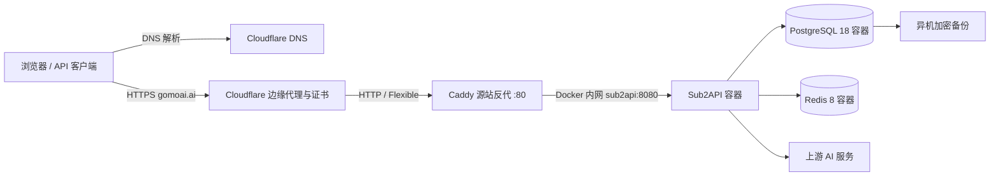

# Sub2API 第一阶段部署方案

日期：2026-10-20。
状态：部署前设计，未购买服务器、构建/发布镜像或修改云端。
代码基线：dev 分支，`b0a02a3304a0a78cdd003ddda1dd23ba02c03084`（当前版本文件为 0.2.17）。

## 1. 已确认范围

- 海外阿里云服务器尚未创建，先确定推荐规格。
- 没有现成 PostgreSQL 和 Redis，初期随应用用 Docker Compose 部署。
- 当前没有 CI 和自有镜像仓库，采用本地构建、打包上传服务器的方式部署。
- 本阶段只部署 Sub2API 主站；供应商模块暂不开发，保留已有设计文档。
- 主站域名为 gomoai.ai，域名注册商为 GoDaddy；DNS、边缘代理与用户侧 HTTPS 使用 Cloudflare。按用户确认采用 Flexible：Cloudflare 到 ECS 使用明文 HTTP，源站不配置证书。
- fork 需要持续合并上游，因此自有部署配置独立维护，不修改上游业务逻辑。

## 2. 推荐服务器

| 项目 | 初期推荐 | 说明 |
| --- | --- | --- |
| 地域 | 优先评估新加坡 | 创建前确认目标上游服务支持、网络出口和主要用户延迟；不保证地域能替代账号可用性验证 |
| CPU / 内存 | 4 vCPU / 8 GiB | 应用、数据库、缓存与反代同机的起步配置，不是经压测得出的并发承诺 |
| 系统 | Ubuntu 24.04 LTS，x86_64 | 使用当前稳定 Docker Engine 和 Compose v2 插件 |
| 存储 | 初期总容量约 100 GiB SSD / ESSD | 可分系统盘与数据盘；用量日志、镜像和备份增长后再扩容 |
| 公网 | 固定公网 IP 或 EIP，初期按 10 Mbps 评估 | 费用与计费方式待采购时确认；图片/音视频场景需单独估算流量 |
| 部署形态 | 单机 Docker Compose | 初期接受单机维护停机，不宣称高可用 |

2 核 4 GiB 更适合作为成本受限的试用环境，不作为本方案生产默认。应用镜像在运维电脑构建，服务器加载镜像包并运行，避免构建挤占在线服务资源。

地域、带宽和实例具体型号须在购买时确认；本轮没有查询实时库存或价格。

## 3. 部署拓扑



四个容器：Caddy、Sub2API、PostgreSQL、Redis。前端已嵌入 Sub2API 镜像，无需另起 Node 前端服务。

- ECS 的 80 端口只允许 Cloudflare 官方公布的 IPv4/IPv6 出口范围，定期更新；源站不开放 443，SSH 仅允许运维来源。用户的 HTTP 到 HTTPS 跳转在 Cloudflare 边缘完成。
- Sub2API 宿主机映射绑定 127.0.0.1:8080，供本机检查；Caddy通过 Docker 内网连接 sub2api:8080。
- PostgreSQL 和 Redis 只在内部网络连接，不发布到宿主机公网端口。
- Caddy 仅监听源站 HTTP 80，不申请、加载或续期源站证书；不需要证书和私钥挂载。Caddy 配置、日志和必要运行数据按部署方式保存。
- goccmax.com 本阶段不发布供应商服务。

## 4. DNS 与 HTTPS

使用 Cloudflare Proxied 模式（橙云）和 Flexible：用户通过 HTTPS 访问 `gomoai.ai`，Cloudflare 通过 HTTP 回源 Caddy，源站无需证书。

必要配置：

- **DNS**：GoDaddy 的 NS 指向 Cloudflare，保留已有业务记录；主站 A 记录指向 ECS 并开启橙云，未启用 IPv6 时不添加 AAAA。
- **HTTPS**：由 Cloudflare 自动管理边缘证书并执行 HTTP 到 HTTPS 跳转；客户端统一使用 `https://gomoai.ai`，保持橙云开启。
- **Caddy**：站点使用 `http://gomoai.ai:80`，反代到 `sub2api:8080`；不配置 TLS 或源站 HTTPS 跳转，设置 `header_up X-Forwarded-Proto https`。源站端口限制见第 3 节。
- **可信代理**：Caddy 仅信任 Cloudflare 出口 IP，严格解析 `CF-Connecting-IP`，以 `{client_ip}` 设置 `X-Real-IP` / `X-Forwarded-For`；Sub2API 仅信任 Caddy。按第 6、8 节显式传入代理参数、关闭后台兼容开关并重启验证，数据库中的设置优先于启动配置。
- **API 与流式请求**：主站 Bypass cache，API 路径避免交互式挑战；SSE 保持自动刷新且不压缩，保留 WebSocket 支持。

上线检查：确认 HTTPS、登录及 OAuth 回调正常，无重定向循环；验证真实 IP、防伪造转发头、端口限制和流式请求，并核对 Cloudflare 套餐的上传大小与回源超时限制，详见第 8 节。

参考：[Cloudflare Flexible](https://developers.cloudflare.com/ssl/origin-configuration/ssl-modes/flexible/)、[仓库入口安全说明](../../deploy/EDGE_SECURITY.md)。

## 5. 本地构建、上传与部署

采用 **本地构建 → 导出镜像包 → SSH 上传 ECS → 加载镜像 → Compose 启动**。

1. **构建**：运维电脑准备 Docker Linux 容器环境和 Buildx；从已确认提交的干净检出，在仓库根目录用现有 `Dockerfile` 构建 `linux/amd64` 镜像，并使用 `--load` 加载到本地。镜像标记为 `sub2api-local:<SHA>`，显式传入 `COMMIT` 和 `VERSION` 构建参数；前端已嵌入应用。
2. **打包上传**：用 `docker save` 导出镜像包，记录源码 SHA、构建参数、镜像 ID 和包文件 SHA256，通过 `scp` / SFTP 上传 ECS。
3. **加载启动**：服务器核对包 SHA256 后执行 `docker load`，确认镜像 ID、标签及 `linux/amd64` 架构与记录一致。生产覆盖文件的应用服务使用对应本地标签，并设置 `pull_policy: never`，不执行应用镜像的远程拉取。
4. **更新回退**：每次发布使用新的标签和镜像包，备份数据库后更新 Compose 中的应用标签并重建应用容器。保留旧镜像包及发布记录；涉及数据库迁移时，按第 7 节判断是否需要恢复数据库。

首次构建仍需下载基础镜像和依赖。PostgreSQL、Redis、Caddy 使用明确版本的官方公共镜像，记录其版本与镜像标识；若 ECS 无法拉取，则在运维电脑预先获取 `linux/amd64` 镜像后一并打包上传。应用镜像以本地标签和镜像 ID 校验，不要求存在镜像仓库 digest。本地构建环境及实际构建结果在实施时验证。

拟定自有配置目录：

```text
ops/deployment/
  PLAN.md                    # 本轮交付
  compose.production.yml     # 后续实现：显式加载的生产覆盖文件
  production.env.example     # 后续实现：无凭据的最小配置模板
  Caddyfile                  # 后续实现：HTTP 80 反代与可信代理配置
  backup.sh                  # 后续实现：一致性备份及异机上传
  DEPLOYMENT.md              # 后续实现：安装、验收、升级和恢复命令
```

以现有 `deploy/docker-compose.yml` 为基线，显式加载生产覆盖文件，固定 Compose 项目名称。覆盖应用镜像和拉取策略、生产参数并增加 Caddy；自有配置集中在 `ops/deployment/`，保留上游文件原样，便于后续合并。检查最终合并的端口、卷、环境变量与网络，不能假设列表字段总是替换。

教程推荐 `docker-compose.local.yml`，主要为了本地目录的备份和迁移便利。本方案采用同仓库的标准 `docker-compose.yml`：标准版已有 `pg_isready + SELECT 1` 就绪检查、120 秒应用启动宽限期和 PostgreSQL 参数传递；本地目录版目前仅检查 `pg_isready`，应用启动宽限期为 30 秒，且没有相同的数据库调参入口。命名卷的备份通过第 7 节的导出流程解决。

后续部署文档使用 fork 固定提交中的文件与自己的镜像。教程一键脚本会从上游 `main` 下载配置并使用上游 `weishaw/sub2api:latest`，不能直接用它发布我们的 fork。当前标准 Compose 也没有转发前述两个可信代理环境变量；`.env` / `--env-file` 仅提供 Compose 插值，不会自动把所有值注入容器，必须在生产覆盖文件的 `environment` 中显式声明。检查最终合并配置及实际容器中的非敏感配置值时，不将完整密钥配置输出到共享日志。

## 6. 初始配置与持久化

采用标准 Compose 命名卷，持久化应用数据、PostgreSQL 和 Redis；Caddy 配置、日志和必要运行数据按部署方式保存，不包含源站证书或私钥。固定项目名称以免重新部署产生另一组空卷。备份通过明确的导出过程完成，不依赖猜测 Docker 的宿主机卷路径。

PostgreSQL 18 必须保留当前的 `PGDATA=/var/lib/postgresql/data` 与同路径卷挂载；不能只改镜像或删掉 PGDATA。

初始化参数建议：

| 参数 | 建议值 / 处理 |
| --- | --- |
| AUTO_SETUP | 使用当前 Compose 的 true；首次初始化自动迁移并创建管理员 |
| RUN_MODE | standard |
| SERVER_MODE | release |
| BIND_HOST | 127.0.0.1，仅控制宿主机端口映射 |
| SERVER_HOST | 容器内保持 0.0.0.0，供 Caddy 经 Docker 内网访问 |
| SECURITY_TRUST_FORWARDED_IP_FOR_API_KEY_ACL | false；还需将后台持久化的 api_key_acl_trust_forwarded_ip 关闭并验收 |
| SERVER_TRUSTED_PROXIES | 明确填写实际 Caddy 地址或专用受控代理网段，不能留空或信任全部来源 |
| TZ | Asia/Shanghai |
| DATABASE_MAX_OPEN_CONNS / MAX_IDLE_CONNS | 50 / 10，压测后再调整 |
| POSTGRES_MAX_CONNECTIONS | 100，留出维护及管理连接余量 |
| POSTGRES_SHARED_BUFFERS | 初期 512MB，随实际资源监控调整 |
| POSTGRES_EFFECTIVE_CACHE_SIZE | 初期 2GB；这是规划器估计值，不是实际预分配 |
| REDIS_POOL_SIZE / MIN_IDLE_CONNS | 初期 128 / 10，压测后再调整 |
| POSTGRES_PASSWORD / REDIS_PASSWORD | 分别生成独立随机密码 |
| JWT_SECRET / TOTP_ENCRYPTION_KEY | 分别生成并固定保存，纳入受控备份 |
| ADMIN_EMAIL / ADMIN_PASSWORD | 部署时指定，密码按应用支持的 8～72 字节范围生成 |

不整体照抄 `.env.example` 的高连接池值。当前示例包含 PostgreSQL 1024 连接、应用 256 连接和 Redis 4096 连接池，不是本机规格的容量结论。生产模板仅包含已确认要传入容器的参数。

密钥保存在服务器受限配置文件或现有密钥管理系统中，不进入 Git、构建参数或镜像层。`/app/data` 包括配置及 `.installed` 安装标记，也需备份；更换容器不重新初始化管理员。

## 7. 备份与回退

初期建议的恢复目标：每日数据库备份，对应目标 RPO不超过24小时；恢复用时目标暂定2小时，必须恢复演练后才可确认。若实际业务需要更小的数据损失窗口，则升级为更频繁备份或 PostgreSQL WAL/PITR方案。

- 使用与服务器兼容的 pg_dump执行一致性逻辑备份；PostgreSQL 18优先使用18版本工具。
- 保存应用数据、部署配置、发布记录、应用镜像包和固定密钥；敏感备份加密并存入异机或 OSS，不能只留在同一 ECS。
- Redis AOF和RDB用于持久化；备份选用完成写入的 RDB或经过停写协调的持久化文件，不直接复制正在改写的 AOF文件作为可靠快照。
- PostgreSQL 与 Redis是不同状态源；恢复方案需要停写协调，并明确会话/缓存重建行为，不能宣称独立备份天然具有跨库一致性。
- 初期保留7份每日备份、4份每周备份，并执行至少一次新环境恢复演练。
- 不在运行中直接 tar PostgreSQL 数据目录充当一致性备份；不使用 `docker compose down -v` 作为升级步骤。

Sub2API 启动自动运行前向数据库迁移。升级前保留旧镜像、做新备份并预留维护窗口。只有确认旧程序兼容新结构时才能仅回退镜像，否则需要恢复数据库及对应配置。单机方案不承诺无停机升级。

第一期备份采用独立脚本或现有运维工具，不依赖额外部署 datamanagementd；该后台数据管理扩展不属于基础运行必需项。

## 8. 上线顺序与验收

1. 确认地域、实例规格、本地构建环境和 SSH 登录方式，创建 ECS 及公网地址。
2. 服务器安装 Docker/Compose，准备生产配置、持久化和备份目标；准备 PostgreSQL、Redis、Caddy 的固定版本镜像。
3. 在运维电脑完成适当的检查与构建，导出并上传应用镜像包；服务器校验包 SHA256、加载镜像并核对镜像 ID、标签和架构。
4. 校验最终 Compose 的镜像、端口、卷、网络和显式环境变量，启动数据库、Redis、应用和 Caddy。正式入口放流前，完成受控管理员登录并将后台 `api_key_acl_trust_forwarded_ip` 保存为 false；重启确认该状态及可信代理配置生效。
5. 检查 Cloudflare 橙云与边缘证书、Flexible 的 HTTP 80 回源、边缘 HTTPS 跳转、外部协议头、真实 IP、伪造转发头处理、源站端口限制及 API 缓存绕过；确认无重定向循环，合格后开放正式流量。
6. 经 Cloudflare域名添加受控的真实上游账号，验证普通请求、长首响应与长时间SSE、需要支持时的 WebSocket，以及用量与费用记录；记录Cloudflare套餐限制与超时表现。
7. 验证容器重启及主机重启后的恢复、数据保留、日志轮转和磁盘监控。
8. 完成异机备份及恢复演练，保存源码 SHA、构建参数、镜像 ID、包 SHA256 和验收结果。

`/health` 当前只返回进程级 `{"status":"ok"}`，不代表数据库、Redis或上游账号可用。验收必须包含登录、数据读取与真实网关请求；不能仅以 HTTP 200宣布可用。

上线后关注 CPU、内存、磁盘增长、数据库连接、错误率、首 Token延迟、活跃并发和备份成功率。扩容由实测决定；需要高可用或写入规模增长时，再将 PostgreSQL/Redis迁至独立服务并增加应用副本。

## 9. 当前交付与下一步

已完成：源码和教程核对、推荐规格、拓扑、发布边界、持久化、备份及验收方案。部署采用本地构建与镜像包上传；HTTPS 采用 Flexible，用户侧使用 Cloudflare 自动管理的边缘证书，源站采用 HTTP。
尚未执行：购买资源、生成生产密钥、创建生产 Compose、构建/发布镜像、DNS修改及远程部署。
下一步：确定地域与资源预算、验证运维电脑的 Docker 构建环境，再生成生产配置和本地构建、上传、更新操作说明。

## 10. 仓库依据与适配范围

本方案以当前代码基线的可执行配置为准；教程用于理解部署流程，示例版本和参数需要与代码核对。

| 决策 | 仓库依据 | 本方案的采用或调整 |
| --- | --- | --- |
| Compose 同机部署 | [中文教程](../../README_CN.md)、[部署教程](../../deploy/README.md) | 沿用应用、PostgreSQL、Redis 三项基础服务，增加 Caddy 对接 Cloudflare |
| Compose 版本及持久化 | [标准版](../../deploy/docker-compose.yml)、[本地目录版](../../deploy/docker-compose.local.yml) | 采用标准版的启动检查及调参能力，保持 PGDATA 与挂载路径一致 |
| 前后端镜像与交付 | [根 Dockerfile](../../Dockerfile)、[构建上下文规则](../../.dockerignore) | 本地构建 linux/amd64，使用 save/load 交付，以镜像 ID 和包 SHA256 校验 |
| 自动初始化 | [AutoSetupFromEnv](../../backend/internal/setup/setup.go) | 保留 AUTO_SETUP、应用数据卷和固定密钥 |
| Cloudflare 与真实 IP | [入口安全教程](../../deploy/EDGE_SECURITY.md)、[Caddy 示例](../../deploy/Caddyfile)、[配置加载](../../backend/internal/config/config.go)、[运行时设置加载](../../backend/internal/service/setting_service.go)、[后台设置保存](../../backend/internal/service/setting_update.go) | Flexible / HTTP 80 回源，显式传递外部 HTTPS 协议，关闭兼容模式，验证数据库设置及真实 IP |
| 备份与升级 | [部署教程](../../deploy/README.md) | 保留前向迁移的回退约束，补充异机备份和恢复演练 |

`deploy/DOCKER.md` 的快速示例仍使用 PostgreSQL 15、Redis 7 和 `DATABASE_URL` / `REDIS_URL`；当前 Compose 使用 PostgreSQL 18、Redis 8，自动初始化读取 `DATABASE_HOST` 等拆分参数。因此不直接复制该旧示例作为生产配置。

4 vCPU / 8 GiB、约 100 GiB 存储、10 Mbps 评估值、连接池参数及备份恢复目标，是针对本次单机环境提出的起点，不是上游最低要求或实测容量；上线前验证并按监控调整。本次交付只修订部署方案，没有生成生产配置、运行构建或改变云端状态。
