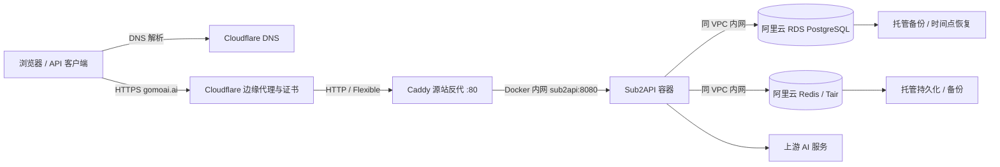

# Sub2API 第一阶段部署方案

日期：2026-10-20。
状态：部署前设计，未购买服务器、构建/发布镜像或修改云端。
代码基线：dev 分支，`b0a02a3304a0a78cdd003ddda1dd23ba02c03084`（当前版本文件为 0.2.17）。

## 1. 已确认范围

- 海外阿里云服务器尚未创建，先确定推荐规格。
- PostgreSQL 和 Redis 均购买阿里云托管实例：阿里云 RDS PostgreSQL 与云数据库 Redis / Tair（Redis 兼容）；通过与 ECS 同地域、同 VPC 的内网地址访问。
- ECS / EIP 公网带宽至少 100 Mbps，采购时确认计费方式、带宽上限及实例网络能力。
- 当前没有 CI 和自有镜像仓库，采用本地构建、打包上传服务器的方式部署。
- 本阶段只部署 Sub2API 主站；供应商模块暂不开发，保留已有设计文档。
- 主站域名为 gomoai.ai，域名注册商为 GoDaddy；DNS、边缘代理与用户侧 HTTPS 使用 Cloudflare。按用户确认采用 Flexible：Cloudflare 到 ECS 使用 HTTP，源站不配置证书。
- fork 需要持续合并上游，因此自有部署配置独立维护，不修改上游业务逻辑。
- 会议要求：自研数据优先新增独立表，避免改动上游表；安全检查和供应商角色越权检查作为上线条件，具体见第 6.2、8 节。

## 2. 推荐服务器

| 项目 | 初期推荐 | 说明 |
| --- | --- | --- |
| 地域 | 优先评估新加坡 | 创建前确认目标上游服务支持、网络出口和主要用户延迟；不保证地域能替代账号可用性验证 |
| CPU / 内存 | 4 vCPU / 8 GiB | 运行应用与反代；数据库、Redis 使用托管实例，不是经压测得出的并发承诺 |
| 系统 | Ubuntu 24.04 LTS，x86_64 | 使用当前稳定 Docker Engine 和 Compose v2 插件 |
| ECS 存储 | 初期总容量约 100 GiB SSD / ESSD | 保存应用配置、日志和镜像；数据库数据占用另计 |
| 公网 | 固定公网 IP 或 EIP，带宽至少 100 Mbps | 会议确定的下限；核对 ECS / EIP 出入方向限制、计费方式和流量费用 |
| PostgreSQL | 阿里云 RDS PostgreSQL，建议从 2 vCPU / 4 GiB、100 GiB 存储评估 | 优先高可用版；具体可售规格、版本、连接上限及备份能力购买时确认 |
| Redis | Redis 兼容的托管主从实例，建议从 2 GiB 内存评估 | 优先标准架构、单一连接地址；启用认证，核对持久化、备份和故障切换能力 |
| 部署形态 | 单台 ECS 上 Docker Compose + 托管数据服务 | 托管数据库高可用不等于整站高可用，应用仍接受单机维护停机 |

2 核 4 GiB 更适合作为成本受限的试用环境，不作为本方案生产默认。应用镜像在运维电脑构建，服务器加载镜像包并运行，避免构建挤占在线服务资源。

地域、实例具体型号和费用须在购买时确认；100 Mbps 是本次确定的公网下限，数据库使用 VPC 内网，不经 Cloudflare 或 ECS 公网地址。当前上游容器示例为 PostgreSQL 18 / Redis 8，云实例版本以地域可售版本及兼容性验收为准，本轮没有查询实时库存或价格。

## 3. 部署拓扑



两个容器：Caddy、Sub2API。PostgreSQL 和 Redis 由阿里云托管，不再随 Compose 启动；前端已嵌入 Sub2API 镜像，无需另起 Node 前端服务。

- ECS 的 80 端口只允许 Cloudflare 官方公布的 IPv4/IPv6 出口范围，定期更新；源站不开放 443，SSH 仅允许运维来源。用户的 HTTP 到 HTTPS 跳转在 Cloudflare 边缘完成。
- Sub2API 宿主机映射绑定 127.0.0.1:8080，供本机检查；Caddy通过 Docker 内网连接 sub2api:8080。
- PostgreSQL 和 Redis 使用内网域名及实例实际端口；不启用公网端点。实例白名单 / 安全组仅放行应用 ECS 的实际内网来源，运维通过受控通道进入 VPC。
- Caddy 仅监听源站 HTTP 80，不申请、加载或续期源站证书；不需要证书和私钥挂载。Caddy 配置、日志和必要运行数据按部署方式保存。
- goccmax.com 本阶段不发布供应商服务。

## 4. DNS 与 HTTPS

使用 Cloudflare Proxied 模式（橙云）和 Flexible：用户通过 HTTPS 访问 `gomoai.ai`，Cloudflare 通过 HTTP 回源 Caddy，源站无需证书。

必要配置：

- **DNS**：GoDaddy 的 NS 指向 Cloudflare，保留已有业务记录；主站 A 记录指向 ECS 并开启橙云，未启用 IPv6 时不添加 AAAA。
- **HTTPS**：由 Cloudflare 自动管理边缘证书并执行 HTTP 到 HTTPS 跳转；客户端统一使用 `https://gomoai.ai`，保持橙云开启。
- **Caddy**：站点使用 `http://gomoai.ai:80`，反代到 `sub2api:8080`；不配置 TLS 或源站 HTTPS 跳转，设置 `header_up X-Forwarded-Proto https`。源站端口限制见第 3 节。
- **可信代理**：Caddy 仅信任 Cloudflare 出口 IP，严格解析 `CF-Connecting-IP`，以 `{client_ip}` 设置 `X-Real-IP` / `X-Forwarded-For`；Sub2API 仅信任 Caddy。按第 6、8 节显式传入代理参数、关闭后台兼容开关并重启验证，数据库中的设置优先于启动配置。
- **API 与流式请求**：主站 Bypass cache，API 路径避免交互式挑战；SSE 保持自动刷新且不压缩，保留 WebSocket 支持。

上线检查：确认 HTTPS、登录及 OAuth 回调正常，无重定向循环；验证真实 IP、防伪造转发头、端口限制和流式请求，并核对 Cloudflare 套餐的上传大小与回源超时限制，详见第 8 节。

参考：[Cloudflare Flexible](https://developers.cloudflare.com/ssl/origin-configuration/ssl-modes/flexible/)、[仓库入口安全说明](../../deploy/EDGE_SECURITY.md)。

## 5. 本地构建、上传与部署

采用 **本地构建 → 导出镜像包 → SSH 上传 ECS → 加载镜像 → Compose 启动**。

1. **构建**：运维电脑准备 Docker Linux 容器环境和 Buildx；从已确认提交的干净检出，在仓库根目录用现有 `Dockerfile` 构建 `linux/amd64` 镜像，并使用 `--load` 加载到本地。镜像标记为 `sub2api-local:<SHA>`，显式传入 `COMMIT` 和 `VERSION` 构建参数；前端已嵌入应用。
2. **打包上传**：用 `docker save` 导出镜像包，记录源码 SHA、构建参数、镜像 ID 和包文件 SHA256，通过 `scp` / SFTP 上传 ECS。
3. **加载启动**：服务器核对包 SHA256 后执行 `docker load`，确认镜像 ID、标签及 `linux/amd64` 架构与记录一致。生产 Compose 的应用服务使用对应本地标签，并设置 `pull_policy: never`，不执行应用镜像的远程拉取。
4. **更新回退**：每次发布使用新的标签和镜像包，备份数据库后更新 Compose 中的应用标签并重建应用容器。保留旧镜像包及发布记录；涉及数据库迁移时，按第 7 节判断是否需要恢复数据库。

首次构建仍需下载基础镜像和依赖。Caddy 使用明确版本的官方公共镜像，记录其版本与镜像标识；若 ECS 无法拉取，则在运维电脑预先获取 `linux/amd64` 镜像后一并打包上传。不交付 PostgreSQL / Redis 服务端镜像，另行记录托管实例 ID、引擎版本和参数。应用镜像以本地标签和镜像 ID 校验，不要求存在镜像仓库 digest。本地构建环境及实际构建结果在实施时验证。

拟定自有配置目录：

```text
ops/deployment/
  PLAN.md                    # 本轮交付
  compose.production.yml     # 后续实现：独立生产文件，仅应用和 Caddy
  production.env.example     # 后续实现：无凭据的最小配置模板
  Caddyfile                  # 后续实现：HTTP 80 反代与可信代理配置
  backup.sh                  # 后续实现：逻辑导出、应用配置备份及异机上传
  DEPLOYMENT.md              # 后续实现：安装、验收、升级和恢复命令
```

参考现有 `deploy/docker-compose.standalone.yml`，在 `ops/deployment/` 维护独立生产 Compose，显式使用该文件启动并固定项目名称。保留应用服务所需参数及数据卷，固定自建镜像和拉取策略，增加 Caddy，并显式配置外部 PostgreSQL / Redis 连接。保留上游文件原样，升级时对照 standalone 的新增参数核对。

不叠加同机版 `deploy/docker-compose.yml`：它固定 `DATABASE_HOST=postgres`、`REDIS_HOST=redis`，并通过 `depends_on` 依赖本地数据服务；只修改 `.env` 不会取消这些服务。最终生产配置中不得出现本地 postgres / redis 服务、依赖或数据卷。standalone 已支持外部地址且没有这些依赖；托管实例就绪检查改为上线前的内网连通、SQL 和 Redis 认证检查，应用启动宽限期先按 120 秒规划，再按实际迁移时间调整。

后续部署文档使用 fork 固定提交中的文件与自己的镜像。教程一键脚本会从上游 `main` 下载配置并使用上游 `weishaw/sub2api:latest`，不能直接用它发布我们的 fork。当前 standalone 未转发前述两个可信代理参数及 `TOTP_ENCRYPTION_KEY`；`.env` / `--env-file` 仅提供 Compose 插值，不会自动把所有值注入容器，必须在生产文件的 `environment` 中显式声明。检查最终配置及实际容器中的非敏感配置值时，不将完整密钥配置输出到共享日志。

## 6. 初始配置与持久化

应用 `/app/data` 继续使用命名卷持久化；Caddy 配置、日志和必要运行数据按部署方式保存。PostgreSQL 数据持久化在 RDS 存储中，Redis 的持久化与备份由托管实例配置负责；删除或重建 ECS 应用容器不删除云数据库。固定 Compose 项目名称，避免应用重新部署时产生另一组空卷。

### 6.1 云实例连接与初始化

购买后先在 RDS 中预建 `sub2api` 数据库及专用账号，只授予应用库内的读写和迁移所需权限。当前程序初始化和启动会执行 SQL 迁移，账号不能仅有 DML 权限；需在目标实例验证建表、索引、序列、函数 / 触发器和迁移锁。无需给应用云平台管理权限或超级用户权限。`pg_trgm` 为可选扩展，可由管理员预启用；缺失时相关模糊搜索索引会被跳过。

Redis 先选标准主从架构、单一兼容连接地址和 DB 0。代码使用普通 `redis.Client`，不直接接入要求 Cluster / Sentinel 客户端的地址；分片、代理集群的 Lua、多键操作、事务及故障切换兼容性需另行验证。配置持久化、备份及内存告警，并核对淘汰策略：Redis 还承载锁、限流、会话等状态，不能按可随意清空的纯缓存处理。

初始化参数建议：

| 参数 | 建议值 / 处理 |
| --- | --- |
| AUTO_SETUP | true；在预建应用库中完成首次迁移并创建管理员 |
| RUN_MODE | standard |
| SERVER_MODE | release |
| BIND_HOST | 127.0.0.1，仅控制宿主机端口映射 |
| SERVER_HOST | 容器内保持 0.0.0.0，供 Caddy 经 Docker 内网访问 |
| SECURITY_TRUST_FORWARDED_IP_FOR_API_KEY_ACL | false；还需将后台持久化的 api_key_acl_trust_forwarded_ip 关闭并验收 |
| SERVER_TRUSTED_PROXIES | 明确填写实际 Caddy 地址或专用受控代理网段，不能留空或信任全部来源 |
| TZ | Asia/Shanghai |
| DATABASE_HOST / DATABASE_PORT | RDS 内网域名及实际端口，通常 5432 |
| DATABASE_USER / DATABASE_PASSWORD / DATABASE_DBNAME | 专用账号、独立随机密码、预建库 sub2api；不再使用本地容器的 POSTGRES_* 参数 |
| DATABASE_SSLMODE | 按 RDS SSL 配置显式设置；启用 TLS 时验证 CA 信任和主机名，不把默认 disable 当作云实例要求 |
| DATABASE_MAX_OPEN_CONNS / DATABASE_MAX_IDLE_CONNS | 初期 50 / 10；所有应用副本的连接预算加上维护余量须小于 RDS 额度 |
| REDIS_HOST / REDIS_PORT | 托管 Redis 内网域名及实例实际端口 |
| REDIS_USERNAME / REDIS_PASSWORD / REDIS_DB | 按实例认证方式设置，ACL 账号填写用户名；使用独立随机密码，DB 先用 0 |
| REDIS_ENABLE_TLS | 按实例 TLS 端点设置；代码支持 TLS 1.2+ 和主机名校验，证书链须被容器信任，不跳过校验 |
| REDIS_POOL_SIZE / REDIS_MIN_IDLE_CONNS | 初期 128 / 10；按实例连接额度和所有应用副本总连接数校核 |
| JWT_SECRET / TOTP_ENCRYPTION_KEY | 分别生成并固定保存，纳入受控备份 |
| ADMIN_EMAIL / ADMIN_PASSWORD | 部署时指定，密码按应用支持的 8～72 字节范围生成 |

不整体照抄示例的高连接池值，standalone 的 Redis 连接池默认 1024 也需显式覆盖。RDS 的连接上限、内存及其他数据库参数通过实例控制台 / 参数模板管理，不再用 `POSTGRES_MAX_CONNECTIONS`、`PGDATA` 或本机卷设置。云服务 TLS 与网站的 Cloudflare Flexible 是独立配置，源站仍不需要网站证书。

密钥保存在服务器受限配置文件或现有密钥管理系统中，不进入 Git、构建参数或镜像层。`/app/data` 包括配置及 `.installed` 安装标记，也需备份；更换容器不重新初始化管理员。

### 6.2 自研数据与供应商权限边界

- 新增供应商能力优先使用独立数据库、自有表、专用数据库账号和迁移历史，可与主库共用同一 RDS 实例。自研扩展不修改上游 `users`、`accounts`、`usage_logs` 表，也不在上游角色枚举中增加 supplier；Sub2API 自身的正常升级迁移仍照常执行。
- 供应商模块的数据库账号只允许访问模块业务库；共享实例时检查默认 CONNECT / schema 权限并显式收紧。模块通过内部 HTTP 适配器调用主服务，不能凭数据库账号直接读写主库。具体数据归属与同步遵循[供应商架构方案](../../extensions/supplier/docs/architecture.md)。
- 供应商身份从服务端会话推导，每个读写入口校验成员状态、资源归属、允许动作和字段范围；不能信任前端传入的 supplier_id 或只隐藏页面按钮。
- 覆盖账号、代理、OAuth 会话、任务、批量 ID、全部账号用量及导出等实际开放接口；平台运营入口单独校验真实访问者的平台管理员身份，不能用适配器持有的管理员 Key 证明访问者是管理员。
- 管理员 Key 与 OAuth 凭据仅在服务端受控保存，响应及日志脱敏。供应商模块启用前必须完成第 8 节的横向、纵向越权验收，本阶段继续不发布供应商入口。

## 7. 备份与回退

RDS 开启自动数据备份与日志备份，按所购实例能力配置 PITR（时间点恢复）及保留期。初期目标 RPO 不超过 24 小时、RTO 暂定 2 小时；实际可恢复时间点、数据损失窗口和恢复耗时以控制台及演练为准，不能把高可用切换当成备份。

- RDS 托管备份为主要恢复手段，升级前确认备份完成及可恢复时间点；另用与实例主版本匹配的 pg_dump 做逻辑导出，用于独立留存和跨实例迁移。
- 保存应用数据、部署配置、发布记录、应用镜像包和固定密钥；敏感备份加密并存入异机或 OSS，不能只留在同一 ECS。
- Redis 在实例控制台配置持久化和自动备份，验证可恢复的数据范围及保留期；不从 ECS 复制 Redis AOF / RDB 文件。实例类型不支持所需能力时，在采购阶段调整规格。
- PostgreSQL 与 Redis是不同状态源；恢复方案需要停写协调，并明确会话/缓存重建行为，不能宣称独立备份天然具有跨库一致性。
- 云实例自动备份初期目标至少保留 7 天；独立导出保留 7 份每日、4 份每周，结合成本确认生命周期。执行至少一次恢复到新实例、应用重连和业务核对演练。
- 升级不执行实例释放 / 重建或 `docker compose down -v`。恢复先落到隔离的新实例，核对数据后再切换应用连接，保留原实例直到验收完成。

Sub2API 启动自动运行前向数据库迁移。升级前保留旧镜像、做新备份并预留维护窗口。只有确认旧程序兼容新结构时才能仅回退镜像，否则需要恢复数据库及对应配置。更换云实例时，优先评估阿里云迁移服务是否支持当前源 / 目标版本与对象；也可在维护窗口停写后使用 pg_dump / pg_restore。核对序列、索引、用量、余额及 Redis 状态，更新应用连接并重启验证。应用单机仍不承诺无停机升级。

第一期备份采用独立脚本或现有运维工具，不依赖额外部署 datamanagementd；该后台数据管理扩展不属于基础运行必需项。

## 8. 上线顺序与验收

1. 确认地域、实例规格、本地构建环境和 SSH 登录方式，购买 ECS、至少 100 Mbps 公网带宽、同地域同 VPC 的 RDS PostgreSQL 与托管 Redis。
2. 预建应用数据库和账号，配置内网白名单、认证、连接额度及托管备份；从 ECS 验证 SQL 查询、Redis 认证 / PING 和配置的 TLS。服务器安装 Docker/Compose，准备应用数据卷、生产配置、备份目标及 Caddy 固定版本镜像。
3. 在运维电脑完成适当的检查与构建，导出并上传应用镜像包；服务器校验包 SHA256、加载镜像并核对镜像 ID、标签和架构。
4. 校验最终 Compose 仅有应用和 Caddy，以及镜像、端口、卷、网络和云实例连接参数；启动后确认 RDS 迁移及 Redis 初始化成功。正式入口放流前，完成受控管理员登录并将后台 `api_key_acl_trust_forwarded_ip` 保存为 false；重启确认该状态及可信代理配置生效。
5. 检查 Cloudflare 橙云与边缘证书、Flexible 的 HTTP 80 回源、边缘 HTTPS 跳转、外部协议头、真实 IP、伪造转发头处理、源站端口限制及 API 缓存绕过；确认无重定向循环，合格后开放正式流量。
6. 经 Cloudflare域名添加受控的真实上游账号，验证普通请求、长首响应与长时间SSE、需要支持时的 WebSocket，以及用量与费用记录；记录Cloudflare套餐限制与超时表现。
7. 在隔离验收环境验证容器 / 主机重启后的恢复、云实例连接中断及主备切换后的重连、数据保留、日志轮转和资源告警；明确失败请求和进行中流式请求的表现。
8. 完成托管备份恢复、异机逻辑备份恢复和迁移切换演练，保存源码 SHA、构建参数、镜像 ID、包 SHA256、实例版本及验收结果。

安全上线条件：检查应用依赖和基础镜像的已知漏洞、默认 / 弱密码、管理入口鉴权、敏感信息泄露及可触达的 SSRF / XSS 风险；修复可利用的高危问题后再放流。需要访问上游的 URL / 代理功能按用途设定服务端校验规则，重点禁止未授权访问云元数据和内网管理地址；不以“使用云数据库”代替安全验收。

供应商模块后续启用前，用两个供应商和一个普通非成员用户做权限验收：A 不能读取或修改 B 的账号、代理、OAuth 会话、任务及用量，混入 B 的批量 ID 必须整体拒绝；普通用户和供应商不能访问平台运营 / 管理接口或修改管理员字段；停用成员后旧会话也不能继续操作；合法自有资源操作应正常成功。验收必须走真实后端接口，覆盖全账号汇总与分页，不能只检查前端菜单。结果和审计记录留档。

`/health` 当前只返回进程级 `{"status":"ok"}`，不代表数据库、Redis或上游账号可用。验收必须包含登录、数据读取与真实网关请求；不能仅以 HTTP 200宣布可用。

上线后关注 ECS CPU / 内存、磁盘、100 Mbps 带宽利用率与流量费用，RDS 容量 / IOPS / 慢查询 / 连接数，Redis 内存 / 淘汰 / 连接数，以及错误率、首 Token 延迟、活跃并发和备份成功率。扩容由实测决定；数据服务先升级托管规格，需要应用高可用时再评估负载均衡和多副本。

## 9. 当前交付与下一步

已完成：结合源码、教程及本次会议要求修订推荐规格、托管数据服务拓扑、发布边界、持久化、备份和安全验收方案。公网带宽至少 100 Mbps；部署采用本地构建与镜像包上传；HTTPS 继续采用 Cloudflare Flexible。
尚未执行：购买资源、生成生产密钥、创建生产 Compose、构建/发布镜像、DNS修改及远程部署。
下一步：确认 ECS / RDS / Redis 所在地域、实例版本与规格、内网接入和预算，验证运维电脑的 Docker 构建环境，再生成生产配置和本地构建、上传、更新操作说明。

## 10. 仓库依据与适配范围

本方案以当前代码基线的可执行配置为准；教程用于理解部署流程，示例版本和参数需要与代码核对。

| 决策 | 仓库依据 | 本方案的采用或调整 |
| --- | --- | --- |
| 外部数据库部署 | [外部服务版](../../deploy/docker-compose.standalone.yml)、[中文教程](../../README_CN.md)、[部署教程](../../deploy/README.md) | 参考 standalone 编写独立生产文件，仅运行应用和 Caddy，连接阿里云托管数据服务 |
| 持久化与连接参数 | [外部服务版](../../deploy/docker-compose.standalone.yml)、[配置加载](../../backend/internal/config/config.go) | 应用卷保留；数据库持久化与备份交由托管实例，显式注入外部连接参数 |
| 前后端镜像与交付 | [根 Dockerfile](../../Dockerfile)、[构建上下文规则](../../.dockerignore) | 本地构建 linux/amd64，使用 save/load 交付，以镜像 ID 和包 SHA256 校验 |
| 自动初始化与迁移 | [AutoSetupFromEnv](../../backend/internal/setup/setup.go)、[启动迁移](../../backend/internal/repository/ent.go)、[可选扩展](../../backend/migrations/065_add_search_trgm_indexes.sql) | 预建应用库及账号，核对迁移权限，保留 AUTO_SETUP、应用数据卷和固定密钥 |
| Redis 兼容性 | [客户端配置](../../backend/internal/repository/redis.go) | 普通客户端、ACL 与 TLS 已支持，标准主从优先；集群和故障切换需实测 |
| Cloudflare 与真实 IP | [入口安全教程](../../deploy/EDGE_SECURITY.md)、[Caddy 示例](../../deploy/Caddyfile)、[配置加载](../../backend/internal/config/config.go)、[运行时设置加载](../../backend/internal/service/setting_service.go)、[后台设置保存](../../backend/internal/service/setting_update.go) | Flexible / HTTP 80 回源，显式传递外部 HTTPS 协议，关闭兼容模式，验证数据库设置及真实 IP |
| 备份与升级 | [部署教程](../../deploy/README.md) | 保留前向迁移的回退约束，使用托管备份、独立逻辑导出及新实例恢复演练 |
| 自研表与权限 | [供应商架构](../../extensions/supplier/docs/architecture.md)、[管理接口鉴权](../../backend/internal/server/middleware/admin_auth.go) | 独立数据与迁移，服务端校验成员 / 归属 / 管理员身份，上线前验证横向及纵向越权 |

`deploy/DOCKER.md` 的快速示例仍使用 PostgreSQL 15、Redis 7 和 `DATABASE_URL` / `REDIS_URL`；当前 Compose 使用 PostgreSQL 18、Redis 8，自动初始化读取 `DATABASE_HOST` 等拆分参数。因此不直接复制该旧示例作为生产配置。

100 Mbps 为会议确定的公网带宽下限。ECS 4 vCPU / 8 GiB、约 100 GiB 存储、RDS 和 Redis 起步规格、连接池及恢复目标均为待验收建议，不是上游最低要求或实测容量。本次交付只修订部署方案，没有生成生产配置、购买资源、运行构建、执行安全测试或改变云端状态。
